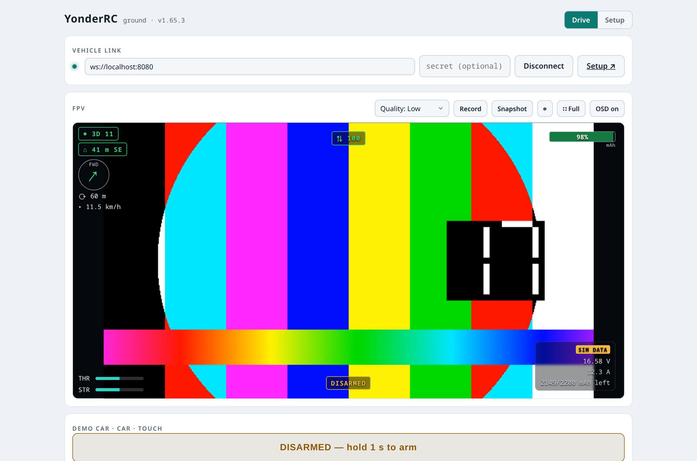

Eine normale RC-Fernsteuerung endet dort, wo ihre Reichweite endet. **YonderRC**
ersetzt sie durch IP: Video, Steuerung und Konfiguration laufen über WLAN oder
LTE, bedient wird im Browser – am PC oder am Handy. Ein Raspberry Pi im Fahrzeug
macht daraus die Servosignale.

*Update 13.11.2026: Die Bodenstation gibt es auch als Desktop-App für Windows und Linux – [zum Update](#update-2026-11-13).*

<figure class="abb klein">
  <a href="/assets/2026-08-28-yonderrc-fernsteuerung-ueber-lte/01-bodenstation-fpv-osd.png">
    
  </a>
  <figcaption>Bodenstation mit FPV und OSD. Hier im Simulator, deshalb das
  Testbild.</figcaption>
</figure>

Dazu kommt das, was eine Fernsteuerung ausmacht: 16 Kanäle mit Trim, Expo,
Endpunkten und Kennlinien, Modellvorlagen für Auto, Boot, Flugzeug und Drohne,
Armen mit Halte-Knopf, Failsafe je Fahrzeugtyp und Telemetrie im Bild. Alles
läuft auch **komplett simuliert**, ganz ohne Hardware.

## Was man mindestens braucht

| Teil | Womit |
|---|---|
| Rechner | Raspberry Pi 4 oder Pi Zero 2 W – beide haben den H.264-Encoder fürs Video. Der Pi 5 hat ihn **nicht**. |
| Karte | microSD 32 GB mit Raspberry Pi OS Lite |
| Servosignale | PCA9685, 16 Kanal über I²C, auf Adresse 0x41 gelegt |
| Strom | UBEC 5 V / 3 A aus dem Fahrakku |

Das war es. Kamera und Stromsensor machen den Aufbau erst rund, nötig sind sie
nicht – ohne sie meldet sich die Simulation. Wer über die Sichtweite hinaus
will, steckt zusätzlich einen **USB-LTE-Stick** an; ein Huawei E3372h-320 tut
es. Am Ende eines Nachmittags im echten Netz standen 110 ms Steuer- und 128 ms
Video-Latenz.

## Installation mit einem Befehl

Auf dem frisch bespielten Pi:

```bash
curl -fsSL https://raw.githubusercontent.com/TechnikWeber/YonderRC/main/provisioning/bootstrap.sh | bash
```

Das holt das Projekt nach `/opt/yonderrc` und richtet den Dienst ein. Danach
`http://<pi-ip>:8080/setup` öffnen und **Detect hardware** drücken: Der Pi geht
den I²C-Bus ab, liest das Kennregister jedes Chips und trägt die Adressen selbst
in die Formulare ein. Auch die Treibermodule installiert diese Seite – kein SSH
nötig. Findet der Pi kein WLAN, macht er seinen eigenen Hotspot auf und schickt
das Handy per Captive Portal direkt auf die Seite.

Code, Teileliste und Verkabelung:
[github.com/TechnikWeber/YonderRC](https://github.com/TechnikWeber/YonderRC)

## Update vom 13.11.2026
{: .update #update-2026-11-13}

**Desktop-App.** Die Bodenstation gibt es auch als eigenes Programm für
Windows und Linux. Sie kann dasselbe wie im Browser, liest Gamepads und
andere Controller aber direkt über SDL. Das lohnt sich, wenn der Browser den
Controller nicht erkennt oder wenn er rütteln soll.

| System | Datei |
|---|---|
| Windows | `…-windows-setup.exe` zum Installieren oder `…-windows-portable.exe` ohne Installation |
| Linux x64 | `…-linux-x86_64.AppImage`, für Debian/Ubuntu `…-linux-amd64.deb` |
| Linux ARM64 (Pi 4/5 mit Desktop, ARM-Laptops) | `…-linux-arm64.AppImage` oder `…-linux-arm64.deb` |

Alles liegt im
[neuesten Release](https://github.com/TechnikWeber/YonderRC/releases/latest).
Die Dateien sind **nicht signiert**. Unter Windows warnt deshalb SmartScreen:
*Weitere Informationen › Trotzdem ausführen*. Ist die intelligente
App-Steuerung an, blockiert Windows sie ganz. Dann bleibt der Browser. Die
AppImage wird automatisch gebaut und ist auf einem echten Linux-Desktop noch
nicht getestet.
