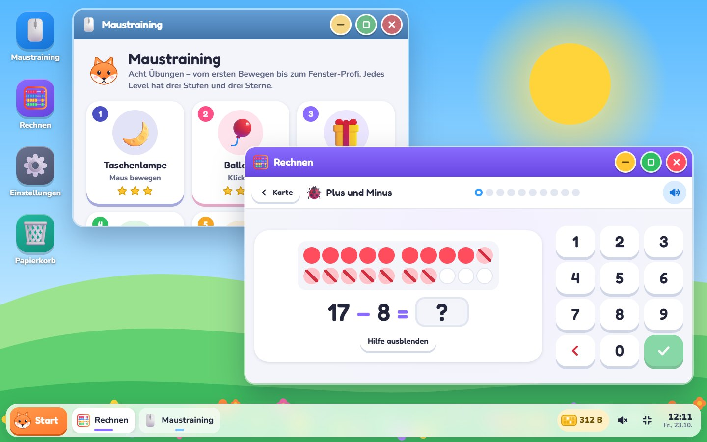

Wie die Lerncomputer aus dem Spielwarenladen, nur kostenlos und auf jedem alten
Laptop: **Computerfuchs** ist ein eigener kleiner Computer im Browser, mit
Fenstern, Taskleiste und Start-Menü – für Kinder von etwa 5 bis 15 Jahren.

**[Ausprobieren: technikweber.github.io/Computerfuchs](https://technikweber.github.io/Computerfuchs/)** · [Quellcode auf GitHub](https://github.com/TechnikWeber/Computerfuchs)

<figure class="abb klein">
  
  <figcaption>Maustraining und Rechnen, nebeneinander in Fenstern.</figcaption>
</figure>

## Ein Computer, der mitwächst

Fünfjährige starten mit großen Symbolen, die auf einen Klick aufgehen. Was ein
echter Rechner kann, schalten sie im Maustraining frei: Doppelklick, Fenster
verschieben, Rechtsklick, Fenster-Knöpfe. Ab zehn ist alles von Anfang an da.
Flinn, der Fuchs, liest jede Anleitung vor – lesen muss niemand können.

## Was drin ist

- **Maustraining:** acht Level mit je drei Stufen, von der Taschenlampe im
  Dunkeln über Ballons und Geschenke bis zum Fenster-Profi
- **Rechnen:** vom Zählen bis zum Kopfrechnen bis 100, mit Zwanzigerfeld und
  Fünferreihen wie in der Grundschule
- **Bytes statt Münzen:** Jeder neue Stern bringt welche, ab 1 Kilobyte ist man
  „Computerfuchs“

Tastatur, Dateien, „Was ist das Internet?“ und weitere Schul-Apps stehen schon
im Start-Menü und kommen nach und nach.

## Technik

Kein Konto, keine Werbung, keine Cookies. Der Fortschritt bleibt im Browser und
lässt sich als Datei sichern. Ziel ist ein alter Laptop, der direkt in
Computerfuchs startet und sonst nichts kann – der Kiosk-Modus dafür ist noch
nicht auf echter Hardware erprobt.
