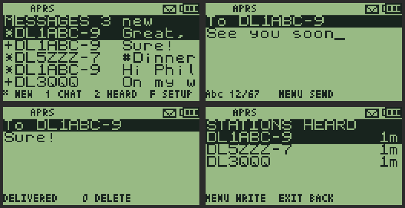
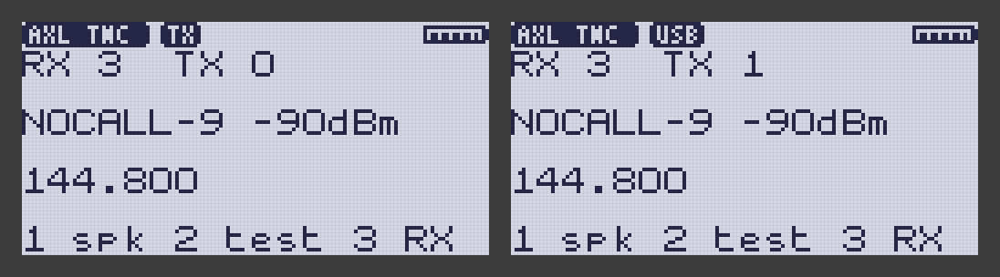
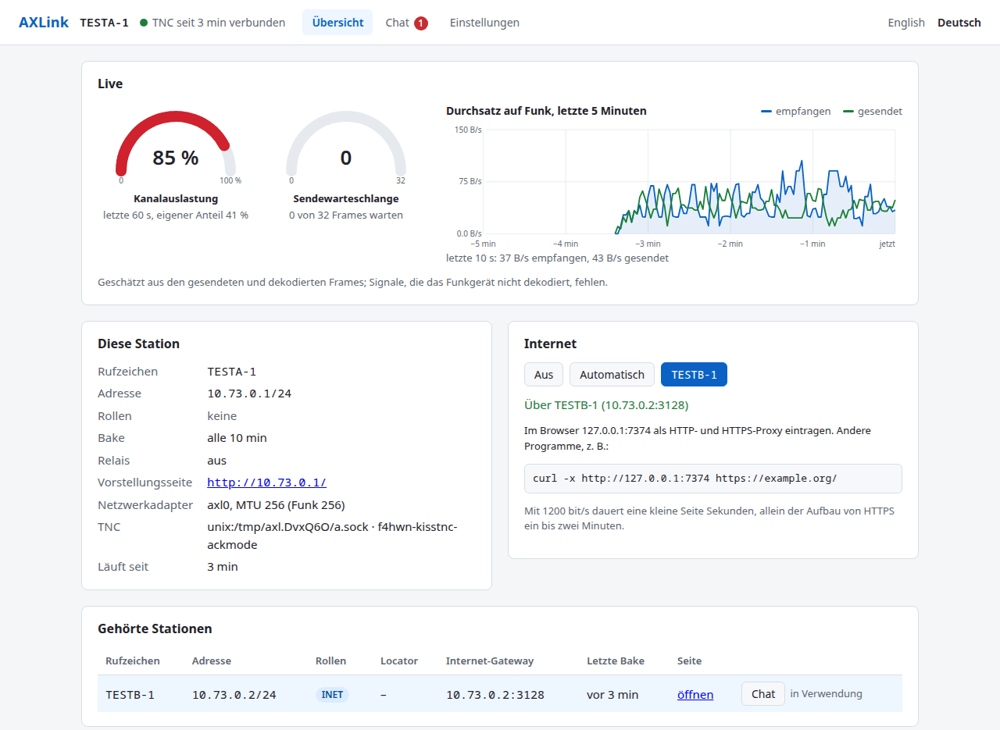
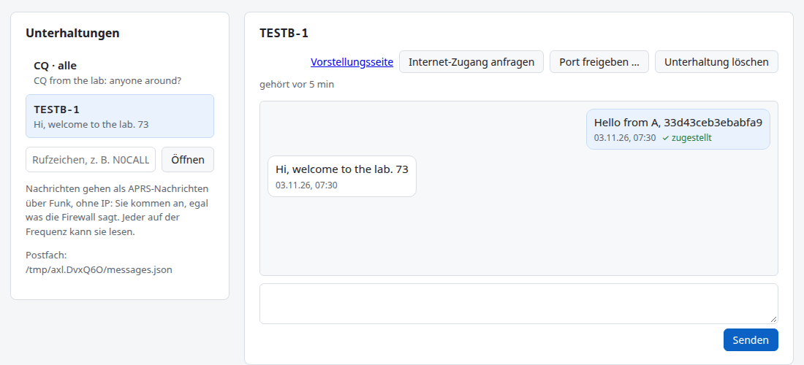
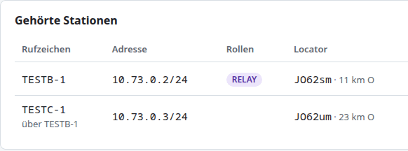
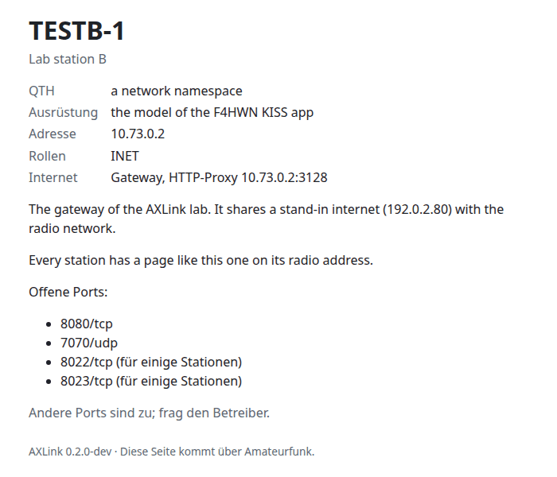
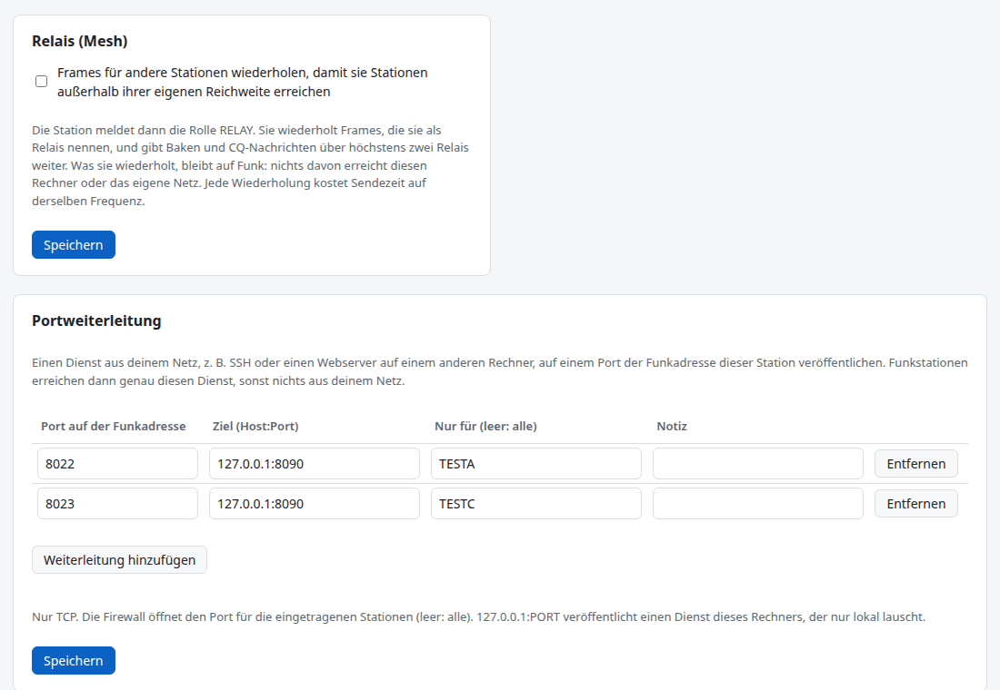
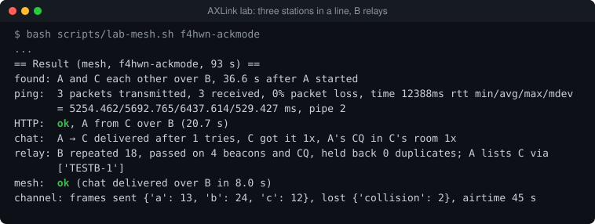
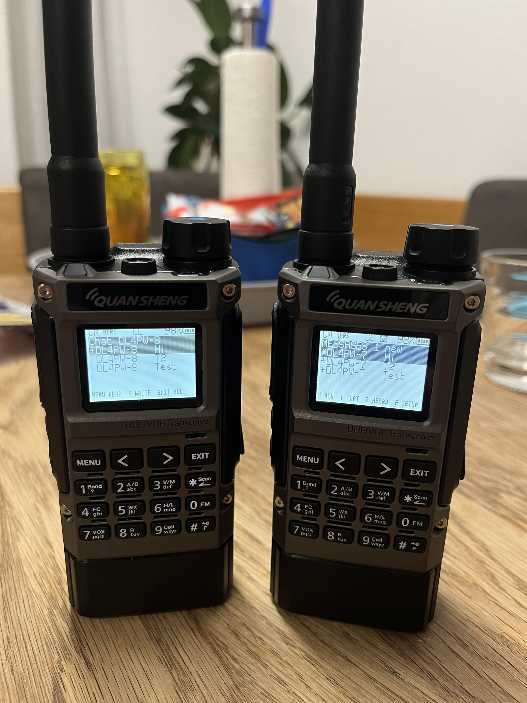

Drei Projekte rund um das Quansheng UV-K1 / UV-K5 V3 mit der F4HWN-Firmware,
die zusammengehören: ein **APRS-Messenger** direkt im Funkgerät, eine
**KISS-TNC-App**, die das Funkgerät zum Modem macht, und **AXLink**, das am PC
daraus einen Netzwerkadapter baut – mit Chat, Relais und Internet-Gateway.

*Update 08.11.2026: Der Messenger läuft auf zwei UV-K1 – [zum Update](#update-2026-11-08).*

<figure class="abb">
  

    <svg viewBox="0 0 580 270" role="img"
         aria-label="Schaubild mit drei Stationen. Links ein UV-K5 mit der
                     Messenger-Firmware, das APRS-Nachrichten direkt am Gerät
                     schreibt und liest. In der Mitte und rechts je ein UV-K5
                     mit der KISS-TNC-App, per USB an einem PC mit AXLink.
                     Zwischen links und Mitte gehen APRS-Nachrichten über Funk,
                     zwischen Mitte und rechts IP-Pakete und Chat. Die PCs
                     bieten Browser, SSH und Chat, der rechte zusätzlich
                     Gateway und Relais.">
      <g font-family="system-ui, sans-serif" font-size="12" fill="#555">

        <!-- Station 1: Messenger -->
        <text x="85" y="22" text-anchor="middle" font-weight="600" fill="#333">Station 1</text>
        <rect x="10" y="34" width="150" height="86" rx="5" fill="#fff" stroke="#b3541e"/>
        <text x="85" y="56" text-anchor="middle" font-weight="600" fill="#b3541e">UV-K5 · Messenger</text>
        <text x="85" y="80" text-anchor="middle">APRS-Nachrichten</text>
        <text x="85" y="98" text-anchor="middle">direkt am Gerät</text>

        <!-- Station 2: TNC + PC -->
        <text x="290" y="22" text-anchor="middle" font-weight="600" fill="#333">Station 2</text>
        <rect x="215" y="34" width="150" height="86" rx="5" fill="#fff" stroke="#333"/>
        <text x="290" y="56" text-anchor="middle" font-weight="600" fill="#333">UV-K5 · TNC-App</text>
        <text x="290" y="80" text-anchor="middle">KISS-Modem</text>
        <text x="290" y="98" text-anchor="middle">1200 Baud</text>
        <line x1="290" y1="120" x2="290" y2="160" stroke="#8a8a85" stroke-width="2"/>
        <text x="298" y="144">USB</text>
        <rect x="215" y="160" width="150" height="96" rx="5" fill="#f0efec" stroke="#8a8a85"/>
        <text x="290" y="182" text-anchor="middle" font-weight="600" fill="#333">PC · AXLink</text>
        <text x="290" y="206" text-anchor="middle">Netzwerkadapter</text>
        <text x="290" y="224" text-anchor="middle">Browser · SSH</text>
        <text x="290" y="242" text-anchor="middle">Chat</text>

        <!-- Station 3: TNC + PC -->
        <text x="495" y="22" text-anchor="middle" font-weight="600" fill="#333">Station 3</text>
        <rect x="420" y="34" width="150" height="86" rx="5" fill="#fff" stroke="#333"/>
        <text x="495" y="56" text-anchor="middle" font-weight="600" fill="#333">UV-K5 · TNC-App</text>
        <text x="495" y="80" text-anchor="middle">KISS-Modem</text>
        <text x="495" y="98" text-anchor="middle">1200 Baud</text>
        <line x1="495" y1="120" x2="495" y2="160" stroke="#8a8a85" stroke-width="2"/>
        <text x="503" y="144">USB</text>
        <rect x="420" y="160" width="150" height="96" rx="5" fill="#f0efec" stroke="#8a8a85"/>
        <text x="495" y="182" text-anchor="middle" font-weight="600" fill="#333">PC · AXLink</text>
        <text x="495" y="206" text-anchor="middle">Webserver · Chat</text>
        <text x="495" y="224" text-anchor="middle">Internet-Gateway</text>
        <text x="495" y="242" text-anchor="middle">Relais</text>

        <!-- Funkstrecken -->
        <line x1="160" y1="77" x2="215" y2="77" stroke="#b3541e" stroke-width="2" stroke-dasharray="5 4"/>
        <text x="187" y="70" text-anchor="middle" font-size="11" fill="#b3541e">APRS</text>
        <line x1="365" y1="77" x2="420" y2="77" stroke="#333" stroke-width="2" stroke-dasharray="5 4"/>
        <text x="392" y="70" text-anchor="middle" font-size="11" fill="#333">IP + Chat</text>
      </g>
    </svg>
  

  <figcaption>Wie die drei zusammenspielen.</figcaption>
</figure>

## 1. Der Messenger: APRS-Nachrichten ohne Handy

Eine eigene Firmware
([uv-k1-k5v3-aprs-firmware](https://github.com/TechnikWeber/uv-k1-k5v3-aprs-firmware)):
Das Funkgerät dekodiert APRS im Hintergrund, während es normal weiterläuft,
bestätigt Nachrichten an das eigene Rufzeichen, legt sie im Flash ab und
piept. Gelesen und geantwortet wird über die Zifferntasten – privat an eine
Station, an den eigenen Kanal oder in die Lobby (`CQ`).

<figure class="abb klein">
  
  <figcaption>Liste, Schreiben, zugestellt, gehörte Stationen.</figcaption>
</figure>

Geflasht wird im Browser über den
[Web-Flasher](https://technikweber.github.io/uv-k1-k5v3-aprs-firmware/) mit
UV Studio.

## 2. Die TNC-App: das Funkgerät als Modem

Die F4HWN-Firmware Labs v6.3.0 lädt kleine Apps in den Arbeitsspeicher. Die
App **KISS TNC** von Johan Denoyer F4WAT macht das Funkgerät zum KISS-Modem
für APRSdroid oder einen PC: 1200 Baud AFSK auf dem VFO, die Daten über das
USB-C-Kabel.

Für Programme, die viele Pakete schicken, gibt es meine Variante
[AXLink TNC](https://github.com/TechnikWeber/AXLink-TNC). Sie bleibt ein
normaler KISS-TNC und kann zusätzlich:

- **ACKMODE:** Sie meldet dem PC, wann ein Paket gesendet ist – er muss nicht
  mehr schätzen.
- **Verlorene Pakete zählen,** die ankamen, während noch eins wartete.
- **USB-Reset abfangen:** Ein Paket, das HF auf dem Kabel abgeschnitten hat,
  geht nicht mehr verstümmelt in die Luft.

<figure class="abb klein">
  
  <figcaption>Beim Senden und danach, gezeichnet vom Code der App.</figcaption>
</figure>

Jede Änderung ist ein eigener Commit, damit F4WAT sie übernehmen kann.

## 3. AXLink: IP über Funk

[AXLink](https://github.com/TechnikWeber/AXLink) verbindet das Funkgerät mit
dem PC und legt einen Netzwerkadapter an. Ping, Browser, SSH oder ein kleiner
Webserver laufen dann unverändert über AX.25 – nur eben mit 1200 Baud.
AXLink läuft unter Linux, Windows und macOS, die Oberfläche im Browser gibt
es auf Deutsch und Englisch.

<figure class="abb klein">
  
  <figcaption>Live-Anzeige, eigene Station, Gateway und gehörte Stationen.</figcaption>
</figure>

Die Stationen finden sich selbst über kurze Baken, ohne Routen einzutragen.
Wer möchte, sendet seinen Locator mit; dann zeigt die Liste Entfernung und
Richtung.

<figure class="abb klein">
  
  <figcaption>Chat: Nachricht zugestellt, Antwort da.</figcaption>
</figure>

Der **Chat** läuft nicht über IP, sondern als APRS-Nachricht direkt im
Funkpaket: Eine Nachricht kostet rund eine Sekunde Sendezeit, wird quittiert
und bei Bedarf wiederholt. Ist die Gegenstation weg, wartet die Nachricht im
Postfach und geht raus, sobald die Station wieder zu hören ist. Weil es das
gleiche Format ist, kann ein Funkgerät mit dem Messenger aus Teil 1 auf
derselben Frequenz mitschreiben – ganz ohne PC.

<figure class="abb klein">
  
  <figcaption>TESTC-1 ist nur über das Relais TESTB-1 erreichbar.</figcaption>
</figure>

**Relais:** Jede Station wiederholt für andere – standardmäßig an,
abschaltbar, und nur, wenn ein Nachbar das Paket noch nicht haben kann. Baken
laufen über bis zu zwei Relais, und die Stationen merken sich den Weg
zueinander. So erreicht A die Station C, die es selbst nicht hört.

<figure class="abb klein">
  
  <figcaption>Die Vorstellungsseite, über Funk abgerufen.</figcaption>
</figure>

Jede Station hat eine kleine **Vorstellungsseite** auf ihrer Funkadresse. Eine
**Firewall** ist ab Werk an: Rein kommen nur Antworten, Ping und Ports, die
man freigibt – auf Wunsch nur für bestimmte Rufzeichen. Wer abgewiesen wird,
erfährt es sofort. Eine **Portweiterleitung** macht genau einen Dienst aus
dem Heimnetz erreichbar, etwa SSH. Und wer Internet hat, kann es als
**Gateway** teilen; Zugang anfragen geht über den Chat. Zum Fehlersuchen zeigt
der Reiter **Mithören** jedes Paket auf dem Kanal, auch fremde – wie bei
offener Rauschsperre –, und `-pcap` schreibt alles für Wireshark mit.

<figure class="abb klein">
  
  <figcaption>Relais und Portweiterleitung in den Einstellungen.</figcaption>
</figure>

## Wie weit das ist

Alle drei sind gebaut und am Rechner getestet: der Messenger mit simuliertem
Audio, meine TNC-App mit ihrem eigenen Code gegen ein Modell des Funkgeräts,
AXLink in einem Labor mit simuliertem Funkkanal und echten Netzwerkstapeln;
der Netzwerkadapter besteht seinen Test auf allen drei Systemen. Auf dem
Funkgerät erprobt ist bisher nur die Original-App von F4WAT. Für den Rest
stehen die Tests noch aus – zwei UV-K1 sind unterwegs.

<figure class="abb klein">
  
  <figcaption>Labor mit drei Stationen: A erreicht C über das Relais B.</figcaption>
</figure>

## Ausprobieren

- Messenger:
  [Web-Flasher](https://technikweber.github.io/uv-k1-k5v3-aprs-firmware/)
- AXLink TNC: [Releases](https://github.com/TechnikWeber/AXLink-TNC/releases),
  Installation über UV Studio
- AXLink: [Releases](https://github.com/TechnikWeber/AXLink/releases) für
  Linux, Windows und macOS, Schritt für Schritt im
  [QuickStart](https://github.com/TechnikWeber/AXLink/blob/main/docs/QUICKSTART.md)

Mit 1200 Baud teilen sich alle Stationen rund 100 Byte pro Sekunde – eine
Webseite von ein paar Kilobyte braucht also ihre Zeit. Für Nachrichten,
Vorstellungsseiten und kleine Dienste reicht es.

## Update vom 08.11.2026
{: .update #update-2026-11-08}

Die zwei UV-K1 sind da. Beim ersten Test mit dem Messenger gingen
Nachrichten und Bestätigungen zwischen beiden Geräten hin und her, auch mit
Dual Watch. Der eine Fehler, der dabei auffiel – Rauschen hielt den Kanal
belegt –, ist behoben. Strom, Digipeater und APRS-IS teste ich als Nächstes.

<figure class="abb klein">
  
  <figcaption>Links der Chat mit DL4PW-8, rechts neue Post von DL4PW-7.</figcaption>
</figure>
