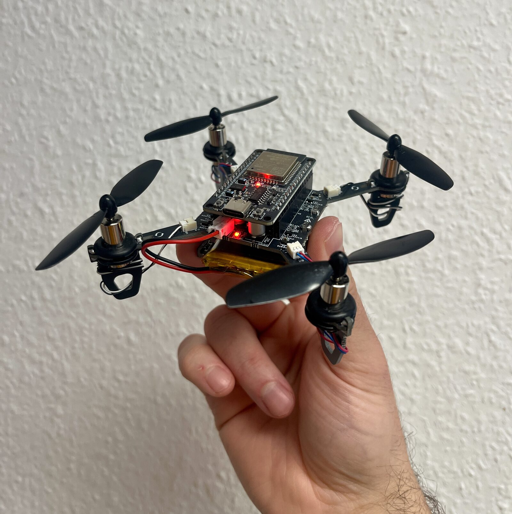
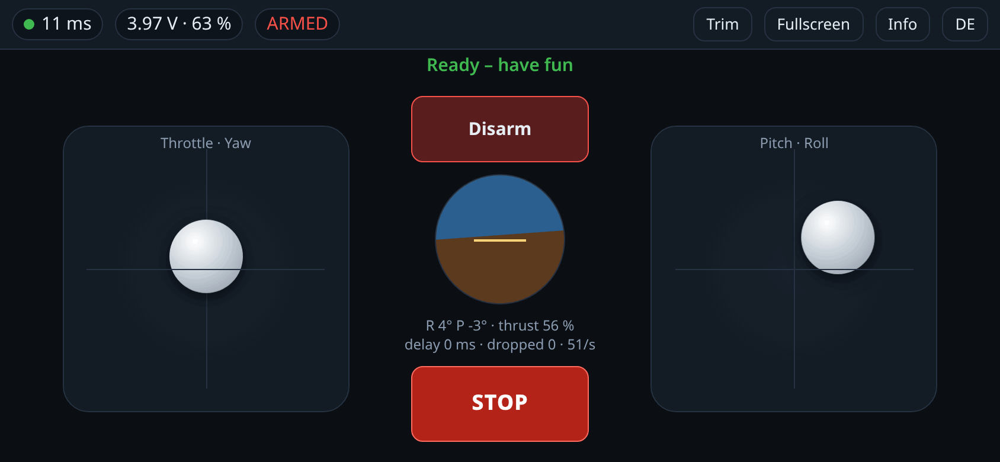

Eine Mini-Drohne für rund 40 €, ein ESP32 als Flugsteuerung – und gesteuert
wird mit dem Handy: ins WLAN der Drohne, die Steuerseite öffnet sich von
selbst. Keine App, kein Konto, kein Internet. Heute ist sie damit zum ersten
Mal geschwebt.

<figure class="abb klein">
  
  <figcaption>E1 Mini mit meiner Firmware, nach dem ersten Schwebeflug.</figcaption>
</figure>

## Das Projekt

Grundlage ist [ESP-Drone](https://github.com/espressif/esp-drone) von
Espressif, eine Flugsteuerung auf Basis des Crazyflie. Mein
[Fork](https://github.com/TechnikWeber/esp-drone) bringt sie auf den
**E1 Mini**, einen günstigen Bausatz mit aufgestecktem ESP32-DevKit, den es
unter vielen Namen gibt („ESP32 Drone“, „E1“). Pins, Sensor und Reglerwerte
habe ich aus dem Schaltplan des offenen Hardwareprojekts und der
Herstellerfirmware übernommen.

## Was meine Firmware mitbringt

- **Steuerung im Handy-Browser:** Die Drohne macht einen eigenen Access Point
  auf, die Steuerseite öffnet sich per Captive Portal. Zwei Sticks, Lage,
  Akku und Verbindungsqualität auf einen Blick, auf Deutsch und Englisch.
- **Robuste Verbindung:** Es zählt nur der neueste Befehl, verspätete werden
  verworfen. Reißt die Verbindung ab, legt sich die Drohne gerade, sinkt und
  schaltet die Motoren ab.
- **Akkuschutz und Trimmung:** Unter 3,0 V landet sie von selbst, unter 3,4 V
  lässt sie sich nicht starten. Gerade ausrichten mit einem Tipp.
- **Bodenstation am PC:** Steuern mit Gamepad, Live-Diagramme, Reglerwerte im
  Flug ändern, Motortest, Flugschreiber – eine HTML-Datei, ohne Installation.
- **Flips** (experimentell): ein Tipp, den Rest fliegt die Drohne selbst.

<figure class="abb klein">
  
  <figcaption>Die Steuerseite, hier mit der simulierten Drohne.</figcaption>
</figure>

## Erprobt

Heute am echten E1 Mini: Das Handy verbindet sich, die Seite öffnet sich, die
Werte kommen an, der Motortest passt und die Drohne schwebt. Zwei Stolpersteine
gab es: Beim Bausatz waren zwei Motoren falsch herum angeschlossen, und der
mitbestellte No-Name-Akku mit 1000 mAh bricht unter Last auf 3,1 V ein – dann
geht der ESP32 aus. Ein Akku mit mindestens 25C muss her. Bodenstation und
Flips stehen auf echter Hardware noch aus.

## Ausprobieren

- Flashen mit einem Klick im
  [Web-Flasher](https://technikweber.github.io/esp-drone/) (Chrome oder Edge)
- Images unter [Releases](https://github.com/TechnikWeber/esp-drone/releases)
- Vom Karton zum ersten Schweben:
  [Getting started](https://github.com/TechnikWeber/esp-drone/blob/webcontrol/docs/getting-started.md)
