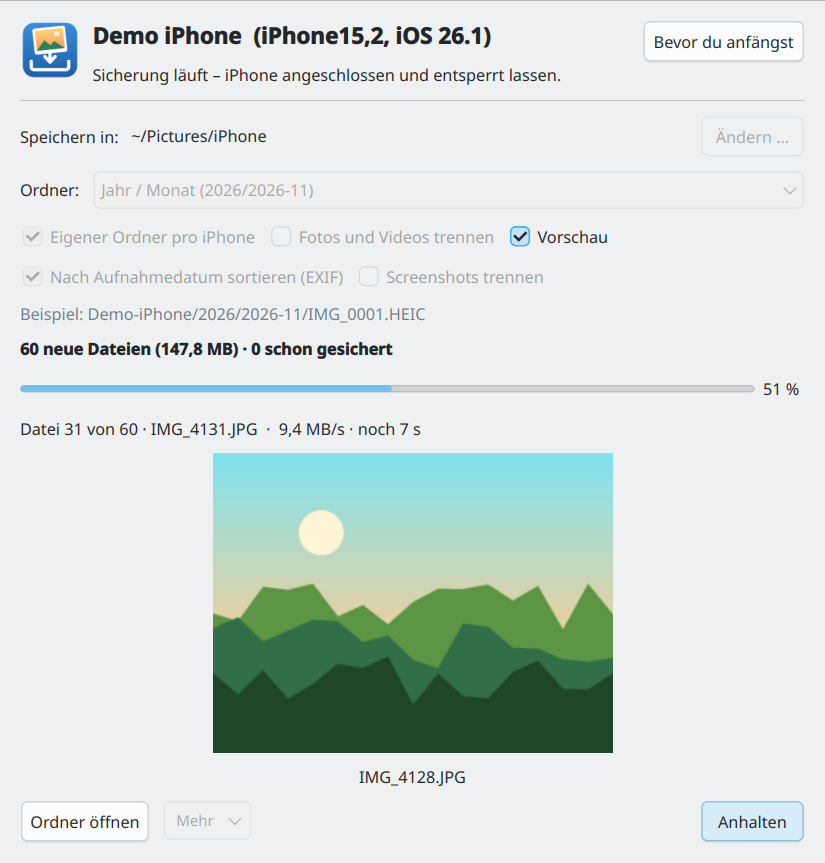
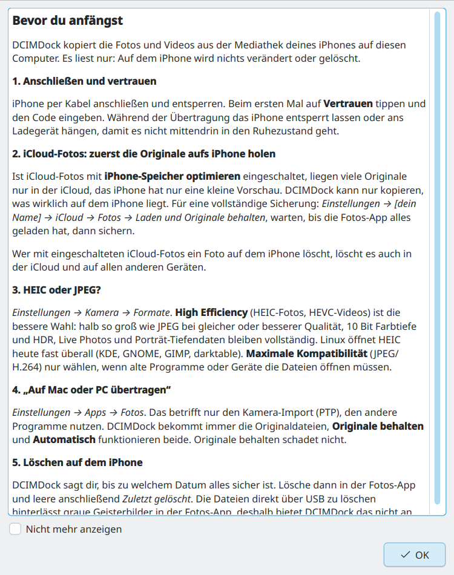
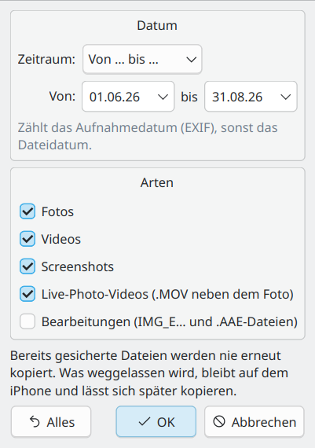

Meine iPhone-Fotos kamen bisher per Spickzettel auf den Rechner:
`idevicepair pair`, `ifuse ~/iPhone`, `cp -a`. Das klappt einmal. Beim
nächsten Mal kopiert `cp` alles noch einmal, und hat das iPhone nach dem
Löschen wieder bei `IMG_0001` angefangen, überschreibt es ältere Fotos
gleichen Namens. Daraus ist **DCIMDock** geworden: ein kleines Fenster, das
nur Neues kopiert und nie etwas überschreibt.

*Update 12.11.2026: Jetzt beta, auch für Windows und mit Auswahl, was kopiert wird – [zum Update](#update-2026-11-12).*

<figure class="abb klein">
  <a href="/assets/2026-11-11-dcimdock-iphone-fotos-unter-linux/01-dcimdock.png">
    
  </a>
  <figcaption>Sicherung läuft, mit Vorschau des letzten Fotos.</figcaption>
</figure>

## Was es kann

- **Nur Neues.** DCIMDock merkt sich pro iPhone, was schon gesichert ist. Der
  zweite Durchgang dauert Sekunden.
- **Nie überschreiben.** Ist ein Name belegt, wird aus `IMG_0001.HEIC`
  `IMG_0001_1.HEIC`. Live Photo, bearbeitete Fassung und `.AAE`-Datei
  bleiben zusammen.
- **Sicher geschrieben.** Jede Datei heißt erst `.part`, bis sie vollständig
  auf der Platte liegt. Ein gezogenes Kabel hinterlässt keine halben Fotos,
  beim nächsten Mal geht es dort weiter.
- **Nur lesend.** Das iPhone wird schreibgeschützt eingehängt, DCIMDock
  löscht nichts. Am Ende sagt es, bis zu welchem Datum alles gesichert ist.
- **Ordner nach Wahl.** Jahr/Monat, mit Tag, nur Jahr oder wie auf dem
  iPhone. Auf Wunsch Fotos, Videos und Screenshots getrennt. Sortiert wird
  nach dem Aufnahmedatum aus den Fotodaten, ein altes importiertes Bild
  landet also in seinem eigenen Jahr.
- **Fortschritt mit Vorschau.** Balken mit MB/s und Restzeit, die Vorschau
  lässt sich abschalten.
- **Mehr.** Alles neu in einen eigenen Ordner kopieren, die Sicherung gegen
  Prüfsummen prüfen und ein Menü *Problemlösung*: hängende iPhone-Ordner
  lösen, neu koppeln, Diagnose. Mehrere iPhones gleichzeitig gehen auch.

Die Bremse ist das USB-Kabel des iPhones, nicht das Programm: Es selbst
schafft über 300 MB/s.

## Vorher lesen

<figure class="abb klein">
  <a href="/assets/2026-11-11-dcimdock-iphone-fotos-unter-linux/02-bevor-du-anfaengst.png">
    
  </a>
  <figcaption>Erscheint beim ersten Start.</figcaption>
</figure>

Die zwei wichtigsten Punkte daraus:

- **iCloud mit „iPhone-Speicher optimieren“:** Viele Originale liegen dann nur
  in der iCloud, auf dem iPhone ist nur eine Vorschau. Vorher auf *Laden und
  Originale behalten* umstellen und warten, bis alles geladen ist.
- **Löschen in der Fotos-App,** nicht über USB. Direktes Löschen hinterlässt
  graue Geisterbilder. Mit iCloud-Fotos verschwinden gelöschte Bilder auch
  auf allen anderen Geräten.

HEIC oder JPEG? *High Efficiency* (HEIC) ist halb so groß bei gleicher
Qualität, und Linux zeigt es inzwischen fast überall an.

## Herunterladen

[DCIMDock auf GitHub](https://github.com/TechnikWeber/DCIMDock/releases/latest)
gibt es als AppImage für jede Distribution und als RPM für Fedora. Dazu
braucht es drei Pakete aus der Distribution, unter Fedora:

```bash
sudo dnf install ifuse libimobiledevice-utils usbmuxd
```

Fehlen sie, zeigt das Fenster den passenden Befehl für Debian/Ubuntu, Arch
und openSUSE. Das AppImage am besten mit
[Gear Lever]() öffnen.

## Stand

Getestet habe ich mit meinem alten Backup (3.342 Fotos und Videos) als
Quelle. Mit einem angeschlossenen iPhone ist es noch nicht gelaufen, deshalb
steht es auf *alpha*. Rückmeldungen gern über die Issues auf GitHub.

## Update vom 12.11.2026
{: .update #update-2026-11-12}

**Beta.** Mit meinem iPhone läuft DCIMDock unter Linux jetzt einwandfrei,
deshalb steht es ab Version 0.2.0 auf *beta*.

**Windows.** Es gibt eine `.exe` (eine Datei, ohne Installation). Dort liest
DCIMDock die Fotos direkt über Apples Dateiprotokoll, ohne etwas einzuhängen.
Voraussetzung ist Apples Treiber aus der App *Apple-Geräte* im Microsoft Store
oder aus iTunes. Fenster und Regeln sind dieselben. Weil die Datei nicht
signiert ist, warnt SmartScreen einmal: *Weitere Informationen* → *Trotzdem
ausführen*. Mit einem echten iPhone unter Windows ist es noch nicht getestet,
Rückmeldungen sind willkommen.

**Auswahl, was kopiert wird** (ab 0.3.0, Linux und Windows). Unter
*Kopieren: Auswählen …*:

<figure class="abb klein">
  <a href="/assets/2026-11-11-dcimdock-iphone-fotos-unter-linux/03-auswahl.png">
    
  </a>
  <figcaption>Nur der Sommer, ohne Bearbeitungen.</figcaption>
</figure>

- **Zeitraum:** letzte 7, 30 oder 90 Tage, dieses oder letztes Jahr oder
  von – bis, nach Aufnahmedatum oder Dateidatum.
- **Arten:** Fotos, Videos und Screenshots einzeln, dazu mit oder ohne das
  Video der Live Photos und die Bearbeitungen.

Ein Live Photo wird dabei nie auseinandergerissen. Was weggelassen wird,
bleibt auf dem iPhone, das Fenster zählt es als *nicht ausgewählt*. Ein
späterer Durchgang ohne Auswahl holt es nach. *Alles neu kopieren* beachtet
die Auswahl und benennt den neuen Ordner danach.

[Zum Download auf GitHub](https://github.com/TechnikWeber/DCIMDock/releases/latest)
