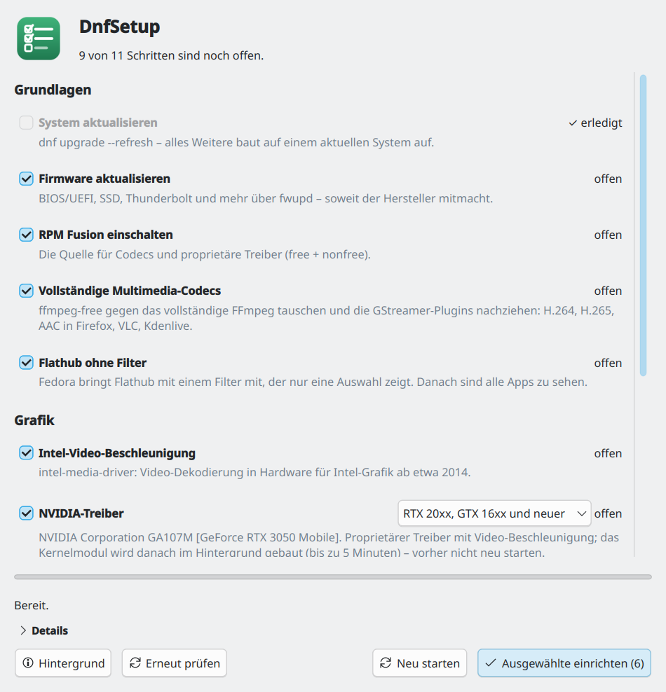
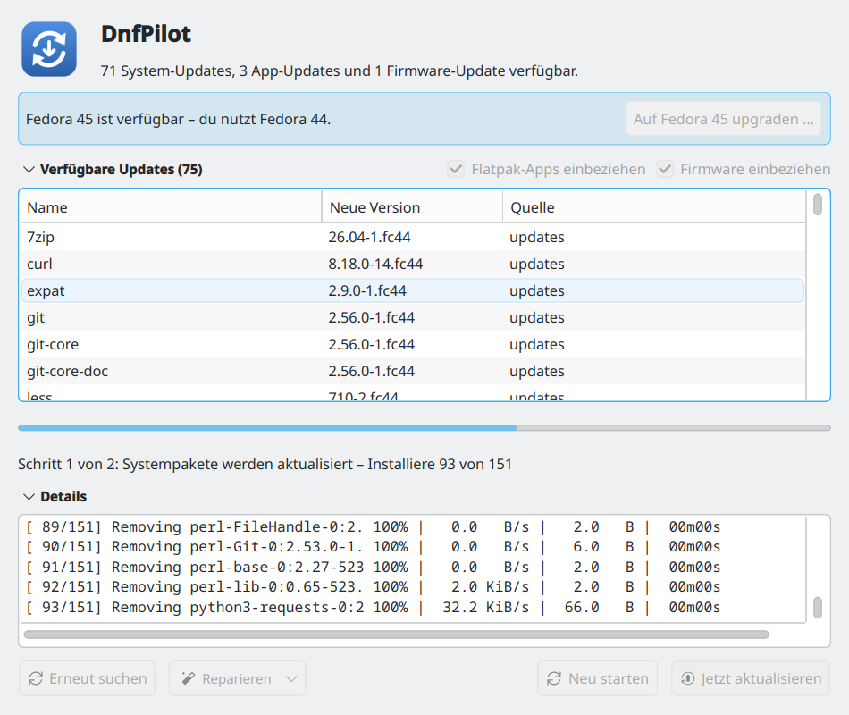

Aus meiner Liste [Fedora KDE: was nach der Installation zu tun ist]()
sind zwei kleine Programme geworden: **DnfSetup** richtet ein frisch
installiertes Fedora ein, **DnfPilot** hält es danach aktuell – beide mit
Fortschrittsbalken statt Terminal und für Fedora 45 geprüft.

## DnfSetup: die Liste zum Abhaken

<figure class="abb klein">
  <a href="/assets/2026-11-11-fedora-einrichten-und-aktuell-halten/01-dnfsetup.png">
    
  </a>
  <figcaption>Frische Installation mit Intel- und NVIDIA-Grafik.</figcaption>
</figure>

DnfSetup prüft beim Start, was schon erledigt ist: Firmware, RPM Fusion,
Codecs, Video-Beschleunigung, Flathub ohne Filter, dazu bei Bedarf Schriften
für Word-Dokumente, OBS, DVDs und `fuse` für ältere AppImages. Den Rest hakt
man an und gibt einmal das Passwort ein.

- **Grafik:** Es zeigt nur die Schritte für die Karten, die im Rechner
  stecken. Bei NVIDIA wählt es die Treiberreihe aus dem Kartennamen –
  aktuell, 580xx oder 470xx.
- **Neustart:** Der Knopf bleibt gesperrt, bis das NVIDIA-Kernelmodul gebaut
  ist. Wer zu früh neu startet, hat sonst einen schwarzen Bildschirm.
- **Secure Boot:** Ist es an, ist NVIDIA nicht vorab angehakt, weil das Modul
  erst signiert werden muss.

## DnfPilot: Updates ohne Discover

<figure class="abb klein">
  <a href="/assets/2026-11-11-fedora-einrichten-und-aktuell-halten/02-dnfpilot.png">
    
  </a>
  <figcaption>Update läuft, darüber der Hinweis auf Fedora 45.</figcaption>
</figure>

Discover installiert Systemupdates als Offline-Update beim nächsten Neustart.
Bei mir brach das immer wieder ab mit *„Dateien können nicht heruntergeladen
werden, die Option cacheonly ist aktiviert“*. DnfPilot aktualisiert im
laufenden System: dnf, Flatpak und Firmware in einem Durchgang, mit
aufklappbaren Details und Neustart-Knopf. Das Menü **Reparieren** enthält die
üblichen Rettungsgriffe, etwa ein hängendes Offline-Update von Discover
abbrechen.

Außerdem meldet DnfPilot neue Fedora-Versionen, und zwar ab dem Tag der
Veröffentlichung. Discover liest das aus den AppStream-Daten von Fedora, und
dort stand Fedora 45 nach dem Release am 3. November noch über eine Woche als
Entwicklerversion. Discover meldete deshalb „alles aktuell“. Die Korrektur ist
als Update unterwegs
([Bug 2568647](https://bugzilla.redhat.com/show_bug.cgi?id=2568647)).

## Herunterladen

Beide gibt es als AppImage und als RPM:

- [DnfSetup](https://github.com/TechnikWeber/DnfSetup/releases/latest)
- [DnfPilot](https://github.com/TechnikWeber/DnfPilot/releases/latest)

Das AppImage am besten mit [Gear Lever](https://flathub.org/apps/it.mijorus.gearlever)
öffnen. Es legt den Menüeintrag an und holt neue Versionen selbst.

## Lieber von Hand?

Die Befehle aus dem alten Beitrag gelten weiter, mit zwei Änderungen für
Fedora 45:

```bash
# RPM Fusion – statt "dnf update @core"
sudo dnf install \
  https://mirrors.rpmfusion.org/free/fedora/rpmfusion-free-release-$(rpm -E %fedora).noarch.rpm \
  https://mirrors.rpmfusion.org/nonfree/fedora/rpmfusion-nonfree-release-$(rpm -E %fedora).noarch.rpm
sudo dnf install rpmfusion-free-appstream-data rpmfusion-nonfree-appstream-data

# Schriften für Word-Dokumente – statt msttcore-fonts-installer
sudo dnf install liberation-sans-fonts liberation-serif-fonts liberation-mono-fonts \
  google-carlito-fonts google-crosextra-caladea-fonts
```

- `dnf update @core` endet mit dnf5 meist mit *„No match for argument:
  core“*. Dann fehlen die App-Infos von RPM Fusion, und Discover zeigt deren
  Programme nicht.
- Das `msttcore-fonts-installer`-Paket hat keine Prüfsummen, rpm lehnt es in
  Fedora 45 ab. Liberation, Carlito und Caladea haben exakt die Maße von
  Arial, Times New Roman, Courier, Calibri und Cambria.

Upgrade auf die nächste Version von Hand:

```bash
sudo dnf upgrade --refresh
sudo dnf system-upgrade download --releasever=45
sudo dnf offline reboot
```

## Stand

Jeder Schritt lief auf einem frischen Fedora 45 im Container, der alte
470er-NVIDIA-Treiber baut auf dem Kernel 7.3. Auf echter NVIDIA-Hardware
habe ich DnfSetup noch nicht ausprobiert – Rückmeldungen gern über die
Issues auf GitHub.
