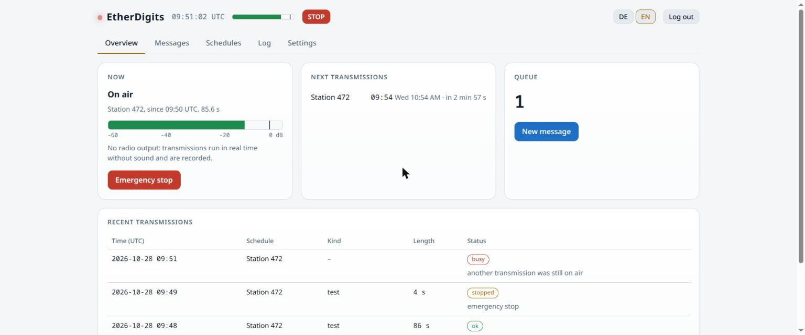
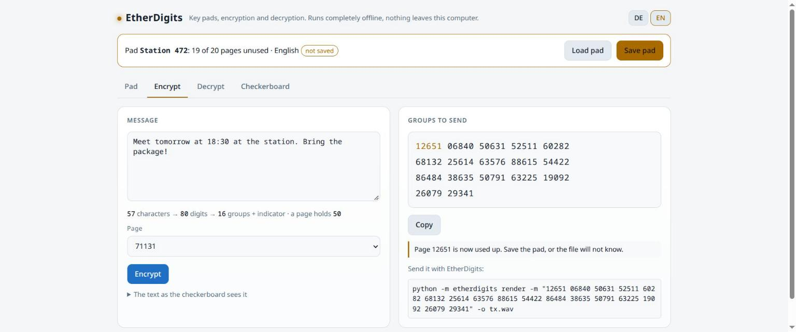

Wer nachts über die Kurzwelle dreht, hört sie manchmal: eine Melodie, dann eine
Stimme, die Zifferngruppen vorliest. Zahlensender. **EtherDigits** baut so
einen Sender nach – mit Pausenzeichen, Kennung, Gruppenzahl, Nachricht,
Wiederholung und Ende, nach Zeitplan, rund um die Uhr.

```
[Pausenzeichen]
ACHTUNG 472 472 472
GRUPPEN 3 3
21347 47890 11203
WIEDERHOLUNG 21347 47890 11203
ENDE
```

<figure class="abb klein">
  <a href="/assets/2026-11-13-etherdigits-eigener-zahlensender/01-uebersicht.jpg">
    
  </a>
  <figcaption>Auf Sendung, mit Pegel und Not-Aus.</figcaption>
</figure>

## Was die Station kann

- **Zeitpläne:** feste Uhrzeiten oder alle N Minuten, in UTC oder Ortszeit,
  mit Stimme (Deutsch, Englisch), Kennung und Frequenz. Leere Termine füllt
  sie mit Zufallsgruppen.
- **Nachrichten und Agenten:** an einen oder mehrere Empfänger, mit Priorität,
  Ablaufdatum und eigenen Sendefenstern je Agent.
- **Protokoll:** jede Aussendung mit Mitschrift und Aufnahme.
- **Hörübung:** zufällige Gruppen nach Gehör mitschreiben, die Station prüft.
- **Ausgabe:** Soundkarte, PTT und CAT fürs Funkgerät, Internet-Stream oder
  einfach eine Audiodatei.

## Das One-Time-Pad

Die Verschlüsselung macht ein eigenes Werkzeug, eine HTML-Datei für einen
Rechner ohne Netz. Sender und Empfänger bekommen dasselbe Pad persönlich in die
Hand, jede Seite wird nur einmal benutzt. Richtig angewendet ist das nicht zu
knacken.

<figure class="abb klein">
  <a href="/assets/2026-11-13-etherdigits-eigener-zahlensender/02-pad-werkzeug.jpg">
    
  </a>
  <figcaption>Links Klartext, rechts die Gruppen für die Station.</figcaption>
</figure>

## Wichtig

Auf Amateurfunkbändern sind verschlüsselte Inhalte **verboten**. EtherDigits
ist für Internet-Stream, Kunstantenne, lokale Wiedergabe oder einen Dienst, der
dafür zugelassen ist. Lizenz: MIT, aber keine militärische Nutzung.

## Ausprobieren

Läuft unter Linux, Windows, macOS und auf dem Raspberry Pi, Bedienung im
Browser unter `http://127.0.0.1:8472/`. Installation mit einer Zeile oder als
einzelne Programmdatei:
[EtherDigits auf GitHub](https://github.com/TechnikWeber/EtherDigits/releases/latest).
Die Ausgabe an ein echtes Funkgerät ist noch nicht getestet.
