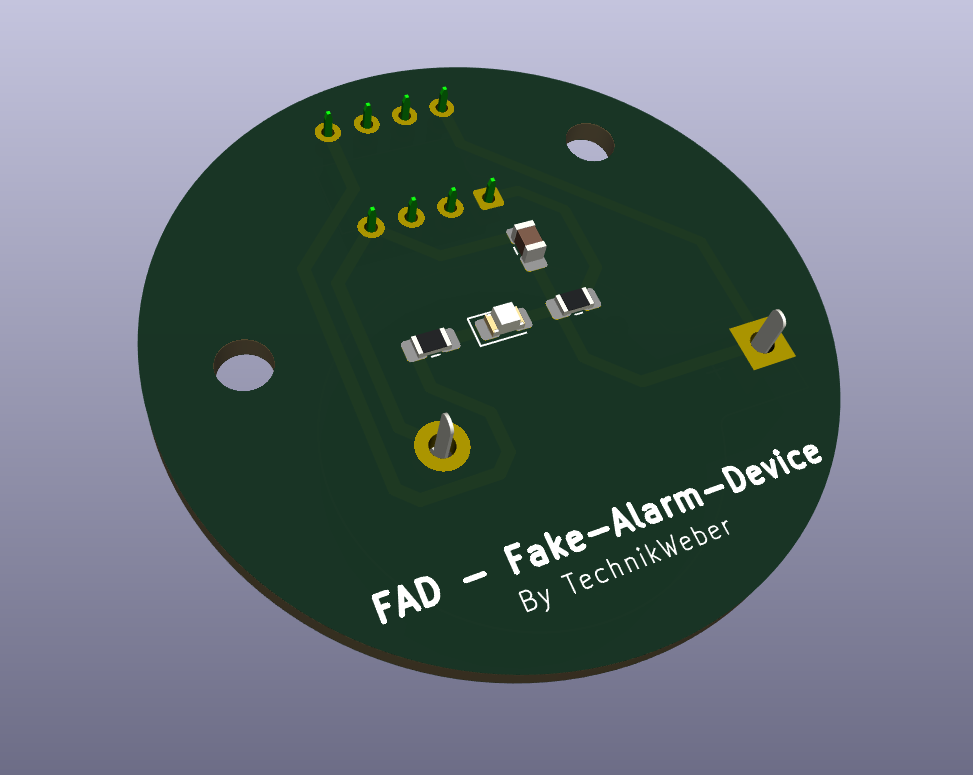
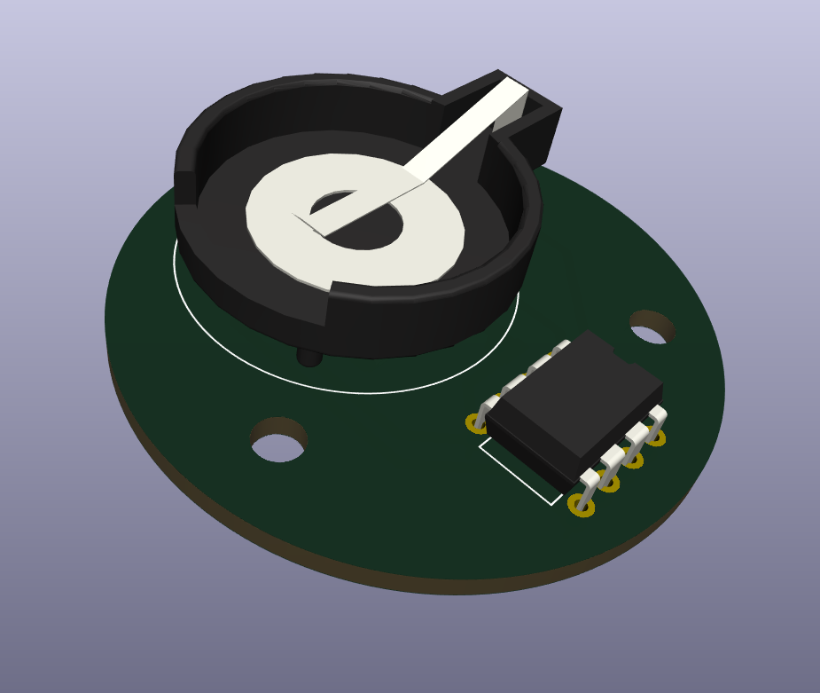
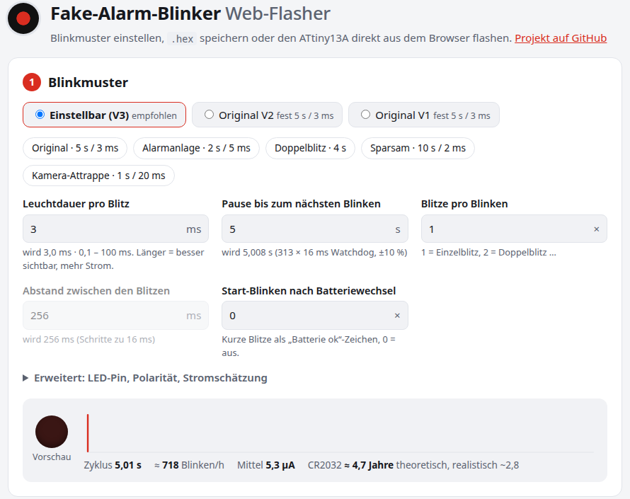



Ein kurzes rotes Blinken alle paar Sekunden – so sieht eine scharf geschaltete
Alarmanlage aus. **FAD** (Fake-Alarm-Device) macht genau das und sonst nichts:
eine runde Platine mit einem ATtiny13A, einer LED und einer CR2032. Die reicht
rechnerisch rund fünf Jahre, realistisch zwei bis drei. Inzwischen läuft es bei
mir ausgiebig getestet und klappt.

<figure class="abb klein">
  
  <figcaption>Vorderseite mit LED.</figcaption>
</figure>

## So spart es Strom

Der ATtiny schläft fast immer (etwa 5 µA) und wird vom Watchdog geweckt. Dann
schaltet er die LED für ein paar Millisekunden ein und schläft weiter. ADC,
Timer und Eingänge sind abgeschaltet, Brown-out-Erkennung auch – die allein
würde 20 µA fressen. Im Mittel sind es rund 5 µA. Der Reset-Pull-up zählt
nicht mit: An beiden Enden liegt VCC, also fließt nichts.

<figure class="abb klein">
  
  <figcaption>Rückseite mit Knopfzellenhalter und ATtiny13A.</figcaption>
</figure>

## Vorwiderstand: lieber kleiner

Das war meine wichtigste Erfahrung: Mit den 3,3 kΩ aus der Stückliste habe ich
anfangs **fast nichts gesehen**. Durch eine rote LED fließen damit nur rund
0,3 mA. Besser ist ein **kleinerer Widerstand und dafür ein kürzerer Blitz**.
Wie hell der Blitz wirkt, hängt vor allem am Strom. Die Batterie zahlt dagegen
Strom × Zeit: 1 ms mit 3 mA kostet so viel wie 3 ms mit 1 mA.

| LED | Vorwiderstand | Strom bei 3 V | Blitz |
|---|---|---|---|
| Rot (wie auf der Platine) | **330 Ω** (220–470 Ω) | ~3 mA | 1–2 ms |
| Gelb, Orange | 270 Ω | ~3 mA | 1–2 ms |
| Grün (modern) | 68 Ω | ~3 mA | 1–2 ms |
| Blau, Weiß | 47 Ω | 2–4 mA | 1–2 ms |
| Low-Current-Rot | 1 kΩ | ~1 mA | 2–3 ms |

Rechnung: `R = (3,0 V − LED-Spannung) / Strom`. Ein Blitz mit 3 mA und 1 ms alle
5 s kostet im Mittel 0,6 µA, die Laufzeit ändert sich kaum. Blaue und weiße LEDs
liegen nah an der Zellspannung und werden mit leerer werdender Batterie dunkler –
Rot ist die sichere Wahl. Über etwa 10 mA sollte man nicht gehen, sonst bricht
die Knopfzelle ein.

## Einstellen und flashen im Browser

Leuchtdauer, Pause, Doppelblitz und ein „Batterie ok“-Blinken beim Einlegen
lassen sich im Web-Flasher einstellen. Eine Vorschau blinkt mit, darunter steht
die geschätzte Laufzeit.

<figure class="abb klein">
  
  <figcaption>Blinkmuster mit Vorschau und Laufzeitschätzung.</figcaption>
</figure>

Danach entweder die `.hex` herunterladen und mit avrdude flashen oder direkt
aus Chrome oder Edge mit einem USBasp (etwa dem Diamex ISP-Prog-NG). Beim Flashen
**entweder** die Knopfzelle raus **oder** die Spannung des Programmers aus –
nie beides gleichzeitig.

- [Web-Flasher](https://technikweber.github.io/ATTINY13A-fake-alarm-device/)
- [FAD auf GitHub](https://github.com/TechnikWeber/ATTINY13A-fake-alarm-device)
  mit KiCad-Projekt und Fertigungsdaten
