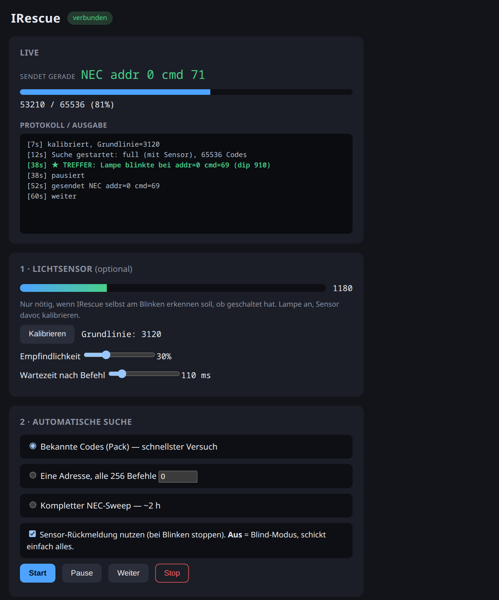
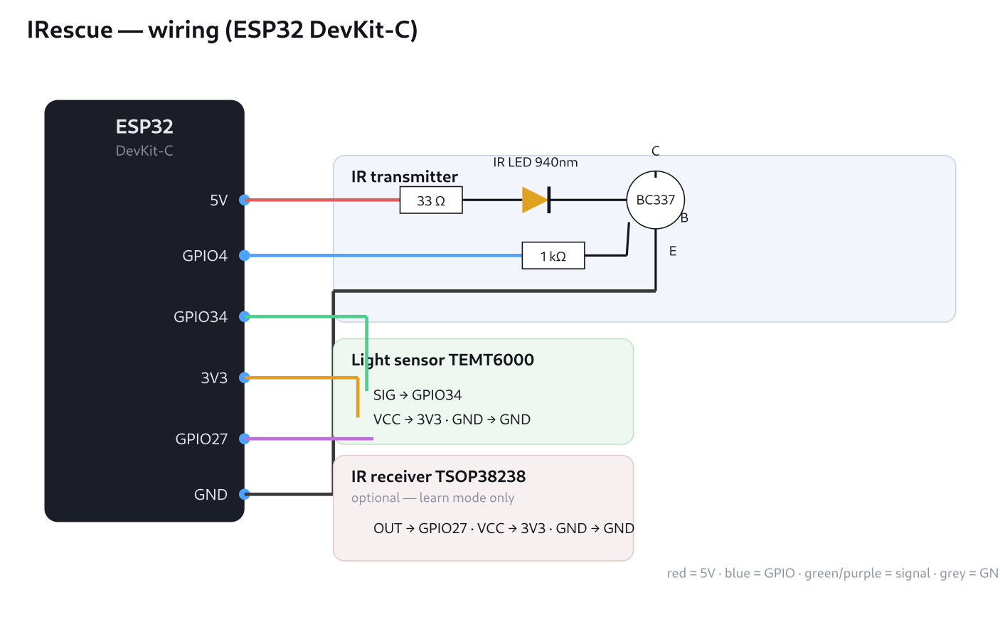



Die Fernbedienung der LED-Lampe ist weg, ein Ersatz nicht zu kaufen. Die Lampe
versteht aber weiter ihre Infrarot-Codes – man muss nur den richtigen finden.
**IRescue** probiert sie mit einem ESP32 und einer IR-LED der Reihe nach durch
und merkt an einem Lichtsensor, wann die Lampe reagiert.

<figure class="abb klein">
  
  <figcaption>Suche läuft, ein Treffer steht schon im Protokoll.</figcaption>
</figure>

## So sucht es

1. **Bekannte Codes zuerst:** Listen aus der freien Flipper-IRDB, passend für
   LED-Lampen und -Streifen. Oft ist der Code damit in Minuten gefunden.
2. **Alles durchprobieren:** Das häufigste Protokoll NEC hat 256 Adressen ×
   256 Befehle – rund zwei Stunden.
3. **Selbst erkennen:** Viele Lampen blinken kurz, wenn sie einen Befehl
   annehmen. Der Lichtsensor sieht das, IRescue hält an und grenzt den Code ein.

Ohne Sensor geht es auch (Blind-Modus): Man schaut selbst auf die Lampe.
Codes lassen sich außerdem einzeln von Hand senden. Später soll IRescue echte
Fernbedienungen anlernen und als Pakete im Flipper-Format teilen.

## Hardware

Ein ESP32-DevKit, eine IR-LED (940 nm) mit Transistor, ein Lichtsensor wie der
TEMT6000 und für das Anlernen ein IR-Empfänger. Kosten: wenige Euro.

<figure class="abb klein">
  
  <figcaption>Verdrahtung, GPIOs in config.h änderbar.</figcaption>
</figure>

Die LED hängt nicht direkt am Pin, sondern am Transistor: So fließen gepulst
rund 110 mA statt 20 mA, das bringt Reichweite.

## Ausprobieren

- Flashen im [Web-Flasher](https://technikweber.github.io/IRescue/) (Chrome
  oder Edge), ganz ohne Entwicklungsumgebung
- Danach ins offene WLAN `IRescue-XXXX`, die Seite öffnet sich von selbst
- Quellcode und Bauteilliste auf
  [GitHub](https://github.com/TechnikWeber/IRescue)

## Stand

Frühe Alpha: Die Firmware baut und lässt sich flashen, an einer echten Lampe
hat sie noch nicht gesucht.
