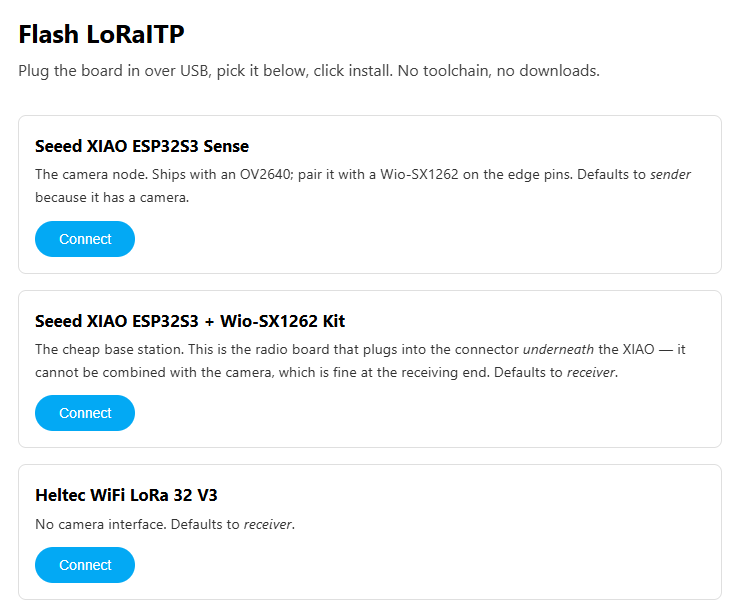

LoRa ist langsam – ein paar hundert Bit pro Sekunde – und in Europa darf man
meist nur 1 % der Zeit senden. Bilder gelten deshalb als unmöglich. Nachgerechnet
stimmt das nicht: Ein 10-kB-Graustufen-JPEG kostet bei größter Reichweite
7 Minuten Sendezeit und 24 mAh. **LoRaITP** ist ein Protokoll, das genau das
erledigt: eine Kamera irgendwo ohne Handynetz, eine Basisstation Dutzende
Kilometer entfernt, ein Akku.

## Die Rechnung

| Bild | Spreizfaktor | reine Sendezeit |
|---|---|---|
| 5 kB | SF12 (max. Reichweite) | 3,6 min |
| 10 kB | SF12 | 7,2 min |
| 10 kB | SF10 | 1,8 min |
| 20 kB | SF10 | 3,6 min |

Im Band 869,4–869,65 MHz (10 % Sendezeit, 500 mW) sind das 5 % des täglichen
Budgets. Ein Akku mit 3000 mAh reicht für rund 125 Bilder.

## Was das Protokoll anders macht

- **Kaum Overhead:** 4 Byte Kopf pro Paket, den Rest (CRC, Länge) liefert LoRa
  schon selbst.
- **Eine Rückmeldung pro Block:** Der Empfänger meldet fehlende Pakete als
  Bitmap statt jedes einzeln zu bestätigen.
- **Sendezeit-Wächter im Protokoll:** Jede Aussendung muss vorher genehmigt
  werden, die Grenzen stammen aus der BNetzA-Verfügung 91/2025.
- **Amateurfunk-Modus:** ohne Sendezeitgrenze, dafür erzwingt er ein Rufzeichen,
  sendet automatisch Kennungen und schaltet die Verschlüsselung ab.
- **Rundspruch ohne Rückkanal:** mit Reed-Solomon-Fehlerkorrektur. Der Empfänger
  weiß exakt, ob das Bild noch zu retten ist.
- **Lieber unscharf als gar nicht:** Ein verlorenes Paket zerstört nur ein paar
  Zeilen, auf Wunsch kommt erst eine kleine Vorschau.

## Hardware und Flashen

Beide Seiten laufen mit derselben Firmware, die Rolle ist eine Einstellung.
Kamera: Seeed XIAO ESP32S3 Sense mit Wio-SX1262. Basis: Heltec WiFi LoRa 32 V3
oder V4.

<figure class="abb klein">
  
  <figcaption>Board wählen, verbinden, fertig.</figcaption>
</figure>

## Stand

Alles baut und besteht die Tests, gefunkt hat noch nichts. Die Spezifikation
ist fertig, eine Python-Referenz überträgt Bilder über einen simulierten Kanal,
der C-Kern besteht 109 Prüfungen. Als Nächstes kommen zwei Boards auf den
Tisch.

- [Web-Flasher](https://technikweber.github.io/LoRaITP/flash/) (Chrome, Edge, Opera)
- [LoRaITP auf GitHub](https://github.com/TechnikWeber/LoRaITP) mit Spezifikation
  und Anleitung für den ersten Test
