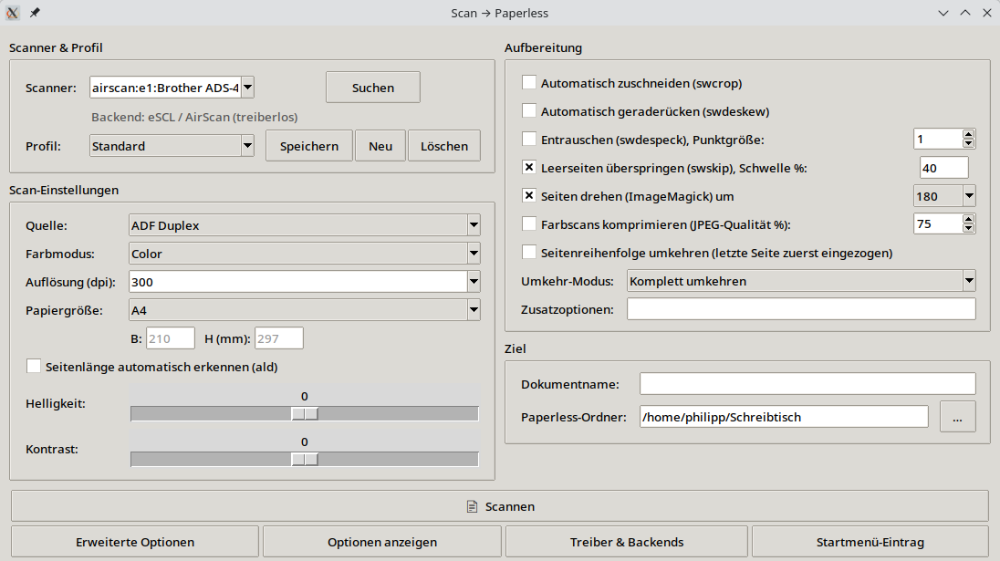

Mein Papierkram landet in Paperless-ngx, das bei mir im
[Proxmox-Server]()
läuft. Der Weg dorthin war bisher umständlich: Scanprogramm, speichern,
Dateiname, in den richtigen Ordner schieben. **scan2paperless** macht das in
einem Schritt: Papier rein, *Scannen*, und das PDF liegt im
Eingangsordner von Paperless. Texterkennung und Ablage übernimmt Paperless.

<figure class="abb klein">
  <a href="/assets/2026-11-13-scan2paperless-scannen-direkt-in-paperless/01-hauptfenster.png">
    
  </a>
  <figcaption>Ein Fenster, ein Knopf.</figcaption>
</figure>

## Was es kann

- **Jeder SANE-Scanner:** Einzug mit Duplex oder Flachbett, Farbe, Graustufen
  oder Schwarzweiß. Die App fragt das Gerät, was es kann, und blendet den Rest
  aus.
- **Ohne Treiber:** Netzwerkscanner wie mein Brother ADS-4300N laufen über
  eSCL/AirScan, per USB mit `ipp-usb`. Das Fenster *Treiber & Backends* richtet
  das ein, auf Wunsch auch Brothers eigenen Treiber und die Scan-Taste am Gerät.
- **Aufbereitung:** zuschneiden, geraderücken, Leerseiten weglassen, Seiten
  drehen, Farbscans als JPEG verkleinern.
- **Profile:** etwa „Brief graustufen“ und „Farbe duplex“, jeweils mit allen
  Einstellungen.
- **Dokumentname:** wird zum Dateinamen und damit zum Titelvorschlag in
  Paperless.
- **Erweiterte Optionen:** alles, was der Scanner sonst noch meldet, pro Profil
  gespeichert.

Für normale Briefe reichen **Graustufen mit 300 dpi**: gute Texterkennung,
kleine Dateien.

## Installieren

Unter Fedora das RPM von
[GitHub](https://github.com/TechnikWeber/sane-linux-scanner-app/releases/latest)
laden und:

```bash
sudo dnf install ./scan2paperless-*.noarch.rpm
```

Danach steht **Scan zu Paperless** im Startmenü. Auf anderen Distributionen
läuft das Python-Skript direkt aus dem Repo, die nötigen Pakete stehen in der
Anleitung. Den Eingangsordner von Paperless (*consume*) bindet man am besten
als Netzlaufwerk ein und wählt ihn unter *Ziel* aus.
