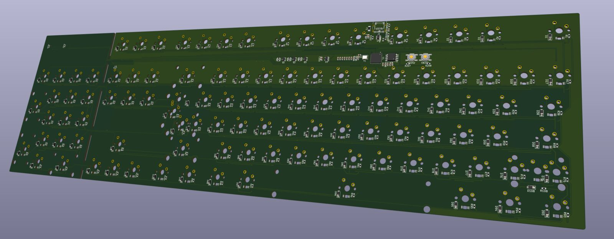
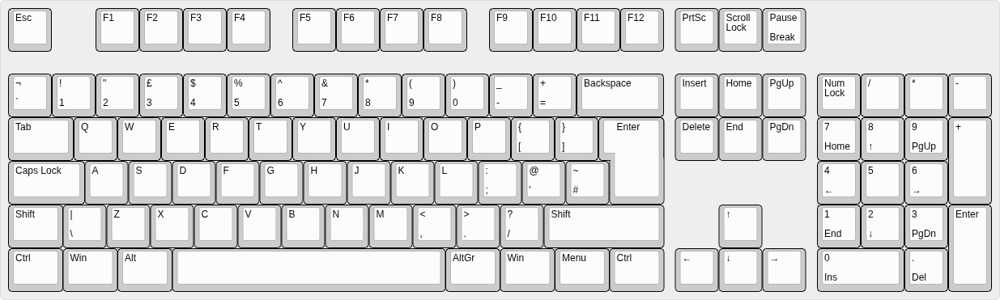

Eine Platine, zwei Tastaturen: volle Größe mit Ziffernblock, und wer den nicht
braucht, bricht ihn entlang einer Sollbruchstelle ab. Übrig bleibt eine
komplette TKL-Tastatur (ohne Ziffernblock) – gleiche Platine, gleicher
Controller, gleiche Firmware. **Für das Gehäuse suche ich noch jemanden.**

<figure class="abb klein">
  
  <figcaption>Bauteilseite, links der Ziffernblock hinter der Bruchkante.</figcaption>
</figure>

## Die Idee

Keine weitere Einzelstück-Tastatur, sondern ein sauberer Kern zum Weiterbauen:
günstig, einfach herzustellen, aktuelles KiCad, QMK, USB-C und Teile, die man
wirklich kaufen kann. Gehäuse, Beleuchtung oder andere Layouts setzen darauf
auf.

## Eckdaten

- **105 Tasten ISO-DE**, als TKL 88. ANSI geht auf derselben Platine, die
  abweichenden Tasten haben eigene Footprints.
- **RP2040** mit 16 Mbit Flash, USB-C mit ESD-Schutz, oder alternativ eine
  Unified Daughterboard.
- **Cherry-MX-kompatible** Schalter, gelötet.
- **Hintergrundbeleuchtung** mit von unten durchleuchtenden 1206-LEDs, per QMK
  gedimmt und „atmend“.
- Der Ziffernblock hängt an **vier Stegen** mit Perforation. Durch ihre Mitte
  laufen die Leiterbahnen hinüber, Controller und USB bleiben auf der TKL-Seite.

<figure class="abb klein">
  
  <figcaption>Das ISO-DE-Layout.</figcaption>
</figure>

## Stand

Schaltplan und Routing sind fertig, die Fertigungsdaten für JLCPCB liegen bei,
die QMK-Firmware kompiliert. Gebaut ist noch nichts. Fünf nackte Platinen
kosten rund 45 $, fünf mit zwei bestückten etwa 112 $. Schalter, Tastenkappen
und Gehäuse kommen dazu.

## Gesucht: Gehäuse

Wer Tastaturgehäuse entwirft – gedruckt, gefräst oder gelasert – und Lust hat:
Umriss, Befestigungslöcher und USB-Position lassen sich noch ans Gehäuse
anpassen. Am besten ein Issue auf
[GitHub](https://github.com/TechnikWeber/convertible-keyboard-pcb/issues)
aufmachen.
