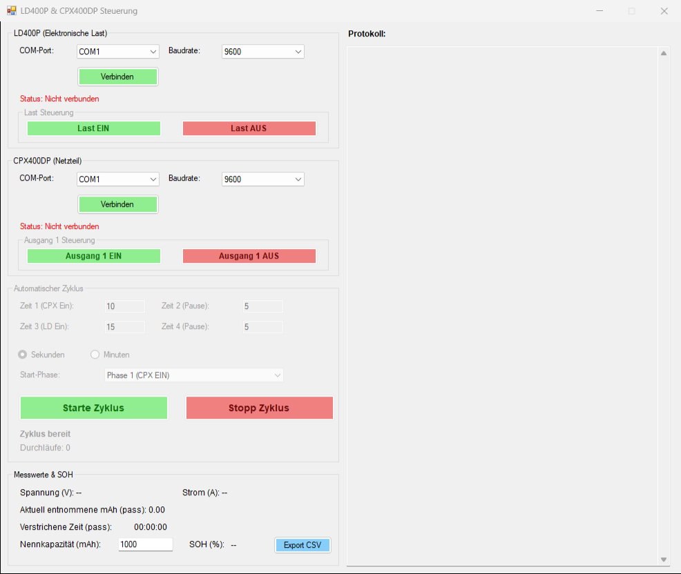
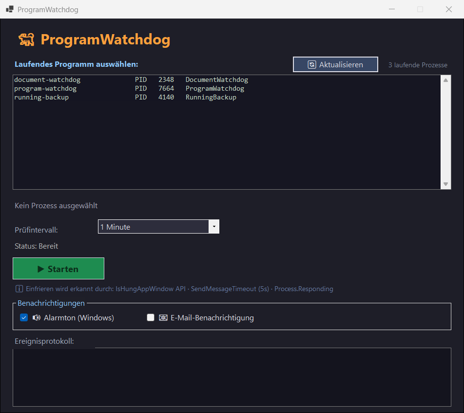
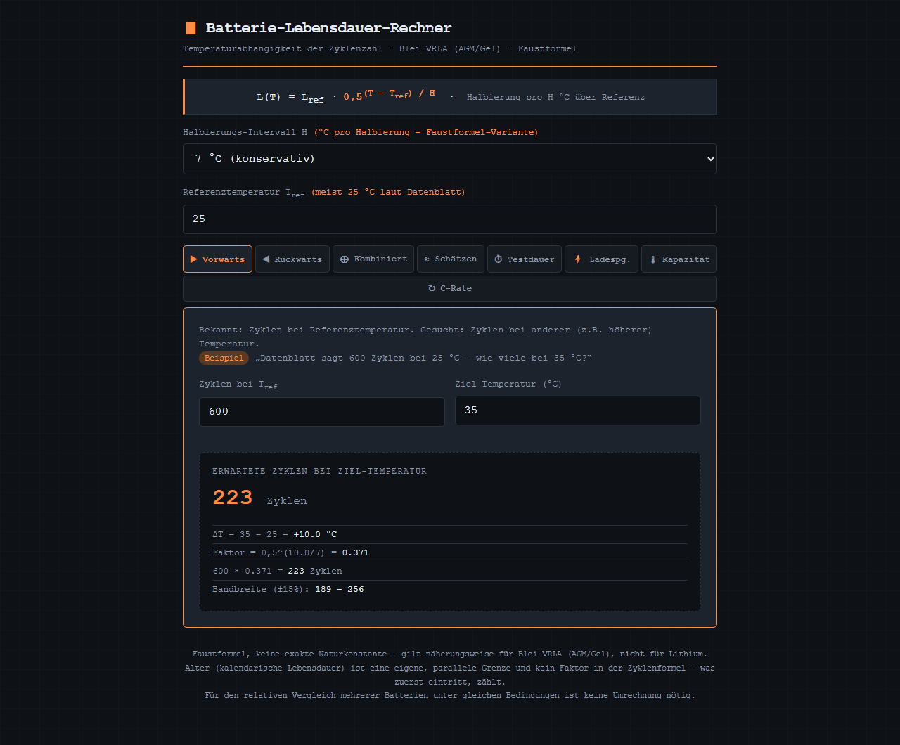



Akkus testen heißt: tagelang laden, entladen, messen. Dafür habe ich mir über
die Jahre kleine Programme geschrieben. Jetzt liegen sie aufgeräumt in vier
Repos – Windows-Programme für die Geräte am Messplatz und zwei Rechner im
Browser.

## bench-tools: Netzteil und Last fernsteuern

Für das Labornetzteil Aim-TTi CPX400DP, die elektronische Last LD400P und das
R&S NGL202. Jedes Werkzeug ist eine einzelne `.exe` ohne Installation.

<figure class="abb klein">
  
  <figcaption>Akku-Zyklen mit Netzteil und Last, ohne angeschlossene Geräte.</figcaption>
</figure>

- **Zyklen:** laden mit dem Netzteil, Pause, entladen mit der Last, Pause – in
  Schleife. Zählt mAh je Durchgang, rechnet den Gesundheitszustand (SOH) gegen
  die Nennkapazität und schreibt CSV.
- **NGL202 übers Netzwerk:** dasselbe per SCPI, mit Kapazität und SOH je Zyklus.
- **Spannungsrampen und Tracking** am CPX400DP.
- **mAh-Korrektur:** Die Uhr der LD400P geht gern nach, dann stimmt ihre
  mAh-Anzeige nicht. Gemessene mAh und Abweichung eingeben, korrigierter Wert
  kommt raus.

## watchdog-tools: Alarm, bevor das Wochenende weg ist

Wenn das Messprogramm am Freitagabend abstürzt, will ich das nicht erst am
Montag merken.

<figure class="abb klein">
  
  <figcaption>ProgramWatchdog passt auf ein laufendes Programm auf.</figcaption>
</figure>

- **DocumentWatchdog:** schlägt Alarm, wenn eine Logdatei nicht mehr wächst.
- **ProgramWatchdog:** schlägt Alarm, wenn ein Programm beendet ist oder hängt.
- **RunningBackup:** sichert eine Datei in festen Abständen mit Zeitstempel,
  auch während ein anderes Programm hineinschreibt.

Alarm gibt es als Ton und auf Wunsch per E-Mail.

## Zwei Rechner im Browser

Datenblätter nennen Zyklen bei 25 °C, Normprüfungen laufen bei 40 °C, mein Test
irgendwo dazwischen. Die Rechner übersetzen zwischen diesen Welten, zeigen jeden
Rechenschritt und eine Spanne, weil es Näherungen bleiben.

<figure class="abb klein">
  
  <figcaption>600 Zyklen bei 25 °C sind bei 35 °C noch rund 223.</figcaption>
</figure>

- **[Bleiakku (VRLA)](https://technikweber.github.io/lead-battery-calculator/):**
  Lebensdauer halbiert sich etwa alle 7 °C, dazu Kapazitätskorrektur nach
  IEC 60254-1, Ladespannung, Prüfdauer und Abnahme nach ISO 7176-25.
- **[Li-Ionen-Zellen (18650/21700)](https://technikweber.github.io/liion-cell-calculator/):**
  Halbierung etwa alle 10 °C, Warnung bei Kälte, SoC-Fenster, CC-CV-Laden für
  NMC, NCA und LFP.

Beide sind je eine HTML-Datei und laufen auch offline.

## Herunterladen

- [bench-tools](https://github.com/TechnikWeber/bench-tools/releases/latest)
- [watchdog-tools](https://github.com/TechnikWeber/watchdog-tools/releases/latest)

Die Programme sind nicht signiert, SmartScreen warnt einmal: *Weitere
Informationen* → *Trotzdem ausführen*.
