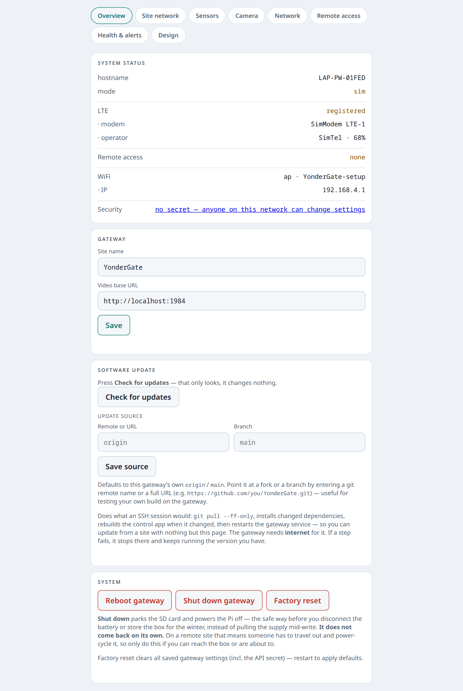
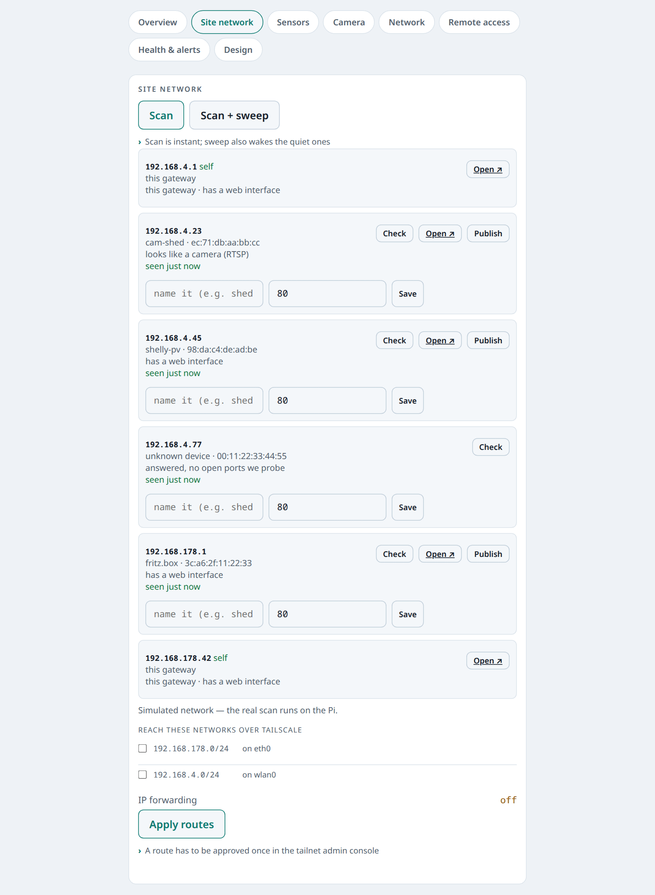
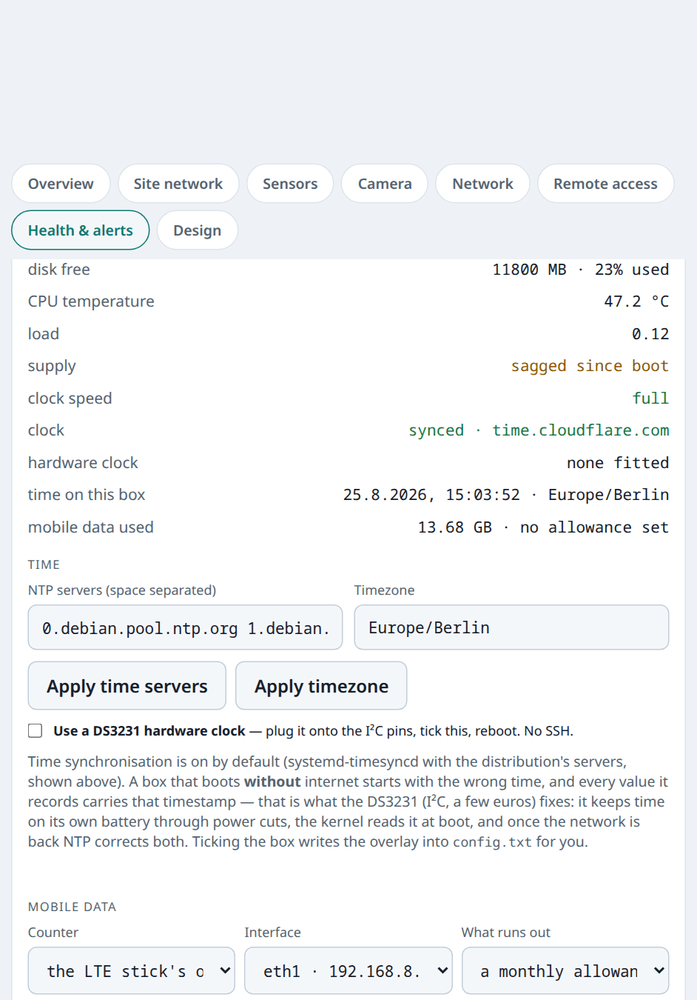

Ein Gartengrundstück mit Solarzelle, eine Hütte, ein Bootsliegeplatz: kein
Internetanschluss, aber Geräte, nach denen man gern schauen würde. **YonderGate**
ist ein Raspberry Pi mit LTE-Stick, der so einen Ort per Tailscale ins eigene
Netz holt. Es ist aus [YonderRC]()
entstanden und übernimmt von dort Einrichtung, LTE, Fernzugriff, Kamera und
Sensoren.

<figure class="abb klein">
  
  <figcaption>Alles über eine Seite im Browser, ohne Bildschirm und SSH.</figcaption>
</figure>

## Was es kann

- **Einrichten per Handy:** Der Pi öffnet einen eigenen Hotspot mit Captive
  Portal. Geräte daran kommen auch ins Internet.
- **Geräte vor Ort finden:** Scan der Nachbartabelle, auf Wunsch Ping über das
  ganze Netz. Nur wenn man fragt – auf LTE zählt jedes Megabyte.
- **Hinkommen:** per Tailscale-Subnetz unter der echten Adresse, oder ein
  einzelnes Gerät auf einem Port des Gateways freigeben.
- **Tunnel nach Zeitplan:** dauernd oder nur in einem Fenster, etwa sonntags
  14:00–14:15. Aussperren kann man sich dabei nicht.
- **Kommt von selbst wieder online:** Ein Wächter prüft, ob wirklich Daten
  durchgehen, und eskaliert vom Tailscale-Neustart bis zum Reboot – höchstens
  zweimal am Tag.
- **Schalten:** Shelly, Tasmota oder ein Relais, auch automatisch, wenn das
  Gerät dahinter nicht mehr antwortet.
- **Meldet sich per ntfy:** Akku schwach, Gerät verstummt, Datenvolumen bei 80 %.

<figure class="abb klein">
  
  <figcaption>Gefundene Geräte vor Ort.</figcaption>
</figure>

## Zustand des Pi

Spannung, Temperatur, Takt, Speicher, Uhrzeitsynchronisation und verbrauchte
Daten – mit dem Unterschied, ob der Pi wegen schwacher Versorgung oder wegen
Hitze drosselt. Von außen sieht beides gleich aus. Sensorwerte bleiben 13
Monate gespeichert.

<figure class="abb klein">
  
  <figcaption>Versorgung, Hitze, Uhr und Datenvolumen.</figcaption>
</figure>

## Was es kostet

Ein Pi Zero 2 W mit LTE-Stick braucht rund 2,5–4 W, also 60–95 Wh am Tag. Die
Seite selbst ist 33 kB groß, der Wächter verbraucht rund 3 MB im Monat. Teuer
wird nur Live-Video: eine Minute 1080p sind etwa 15 MB.

## Stand

Beta, Version 0.19. Auf einem echten Grundstück lief es noch nicht.
[YonderGate auf GitHub](https://github.com/TechnikWeber/YonderGate) mit
Teileliste und Datenbudget.
