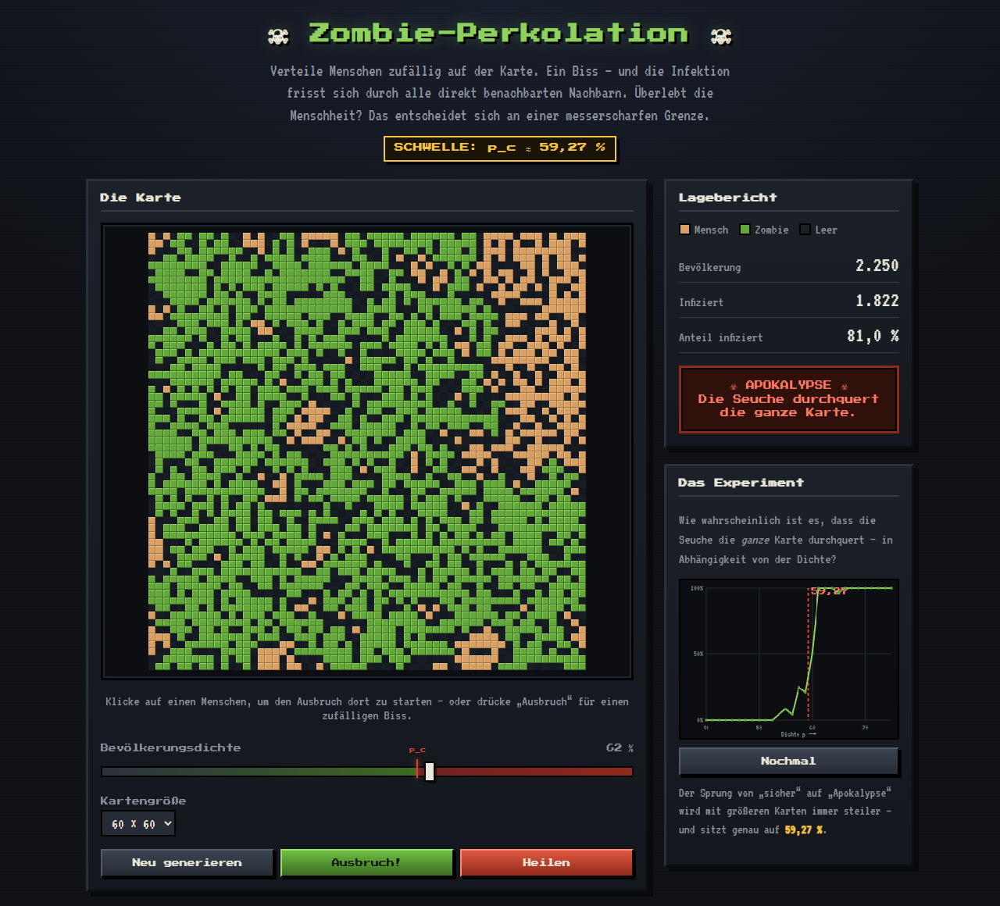
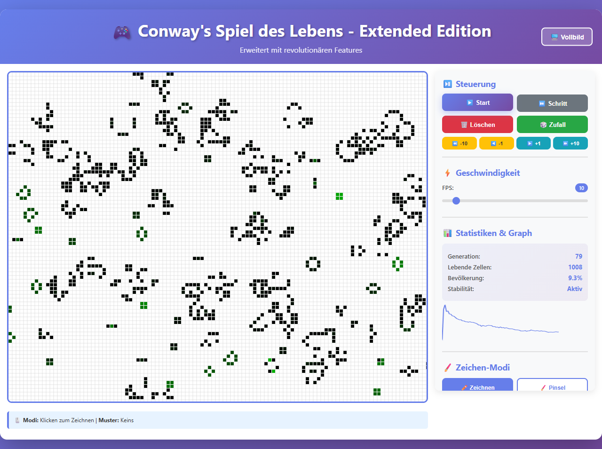

Zwei kleine Spielereien, bei denen aus einfachen Regeln erstaunlich viel
entsteht. Beide laufen direkt im Browser, ohne Installation.

## Zombie-Perkolation: Kipppunkt bei 59,27 %

Menschen stehen zufällig verteilt auf einer Karte. Einer wird zum Zombie und
steckt jeden an, der direkt neben ihm steht. Ob die Menschheit überlebt, hängt
nur an der **Bevölkerungsdichte**:

- **Knapp unter 59,27 %** zerfällt die Bevölkerung in kleine Inseln, der Biss
  bleibt ein örtlicher Vorfall.
- **Knapp darüber** zieht sich plötzlich ein einziges Riesencluster über die
  ganze Karte – ein Biss, und alle sind dran.

<figure class="abb klein">
  
  <figcaption>Bei 62 % Dichte erwischt ein Biss 81 % der Karte.</figcaption>
</figure>

Das ist ein **Phasenübergang**, derselbe Effekt wie bei Waldbränden oder
Epidemien. Das Verblüffende: Der Wert 0,5927… taucht in jeder Simulation auf,
aber bis heute hat ihn niemand mit einer exakten Formel hergeleitet. Der
Experiment-Modus zeichnet die Kurve selbst.

Tipp: Dichte von 57 % auf 61 % schieben und jedes Mal einen Ausbruch starten.

[Zur Zombie-Perkolation](https://technikweber.github.io/percolation-theory-simulator/)

## Conways Game of Life

Ein Raster aus lebenden und toten Zellen, vier Regeln: Wer zu wenige oder zu
viele Nachbarn hat, stirbt, mit zwei oder drei lebt er weiter, bei genau drei
entsteht neues Leben. Daraus wachsen Gleiter, Oszillatoren und ganze Kanonen,
die Gleiter verschießen.

<figure class="abb klein">
  
  <figcaption>Erweiterte Fassung mit Altersfarben und Statistik.</figcaption>
</figure>

Zehn klassische Muster zum Platzieren, sechs Farbschemata. Die erweiterte
Fassung kann zusätzlich in der Zeit vor- und zurückspringen, mit Pinsel und
Spray zeichnen und spiegelsymmetrisch malen.

[Zum Game of Life](https://technikweber.github.io/conways-game-of-life/)
