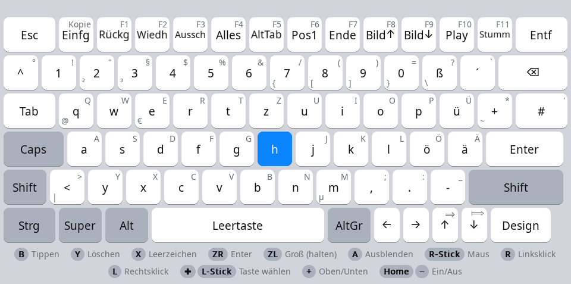
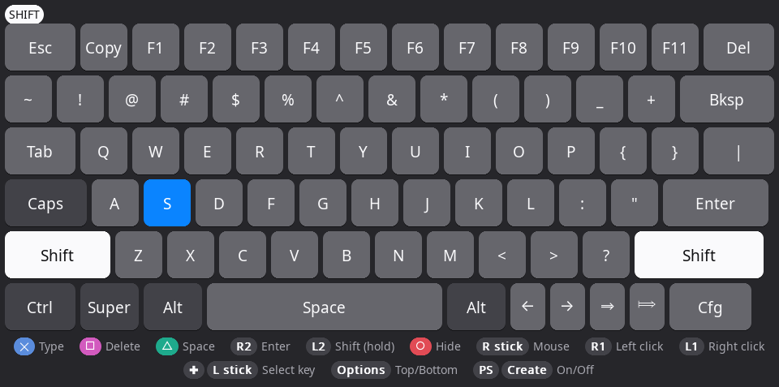
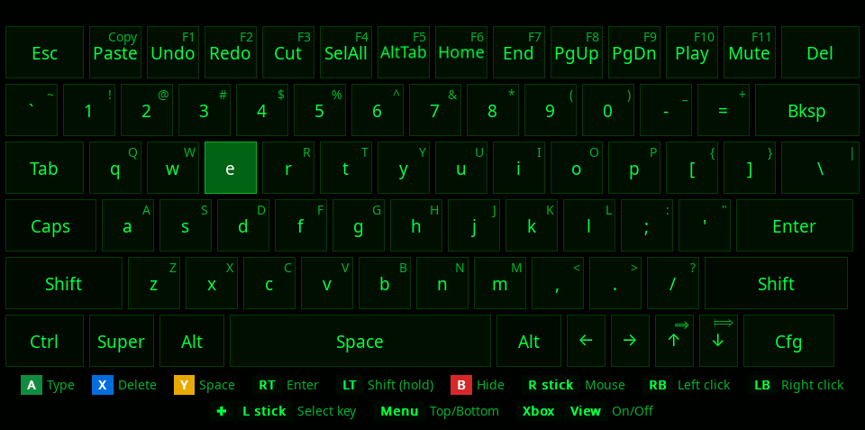
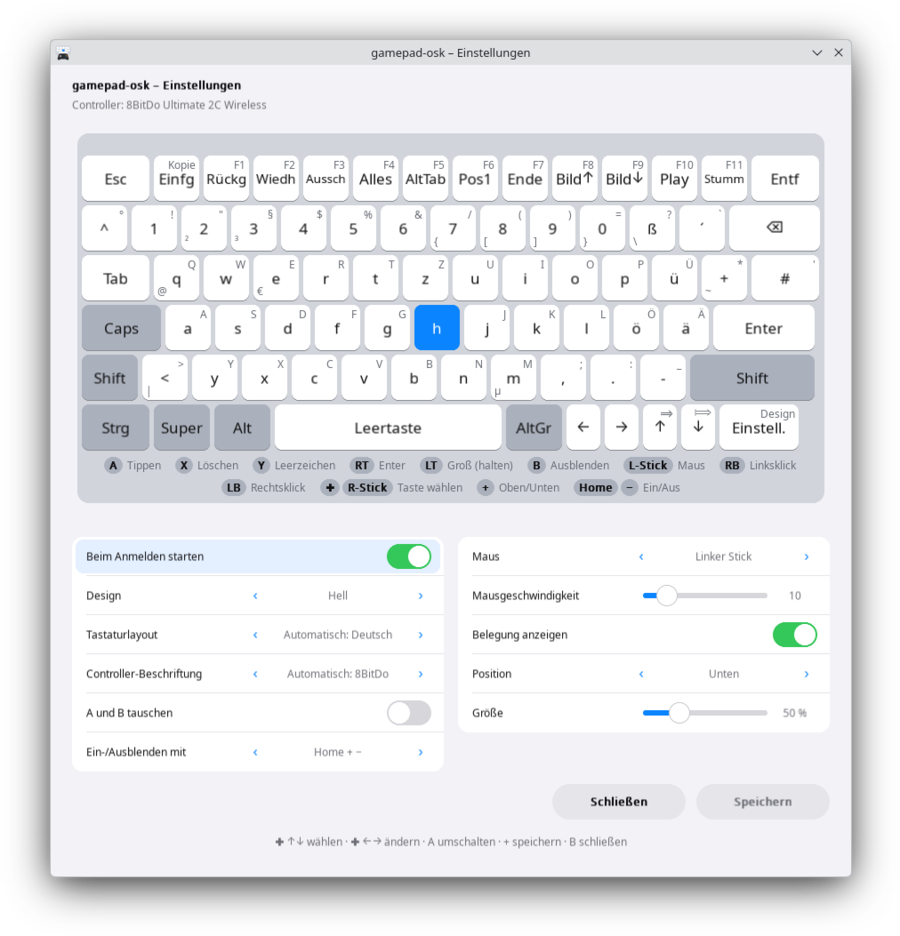
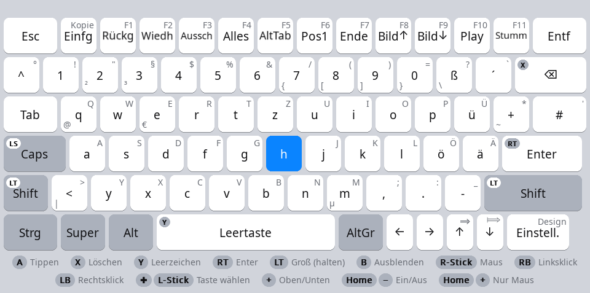

Minecraft spiele ich mit dem Controller vom Sofa aus. Nur zum Tippen musste
bisher die Tastatur her. **gamepad-osk** von *0x90shell* ist eine
Bildschirmtastatur, die auf eine Tastenkombination hin erscheint und komplett
mit dem Controller bedient wird. Ich habe sie für mich angepasst, mein Fork
ist öffentlich.

*Update 15.11.2026: Einstellungsfenster, Mausmodus, Transparenz, eigene Belegung, Buttons auf den Tasten – [zum Update](#update-2026-11-15).*

<figure class="abb klein">
  <a href="/assets/2026-11-15-gamepad-osk-mit-dem-controller-tippen/01-hell-deutsch.png">
    
  </a>
  <figcaption>Mein Fork: hell, deutsch, mit Belegung.</figcaption>
</figure>

## Das Original

[gamepad-osk](https://github.com/0x90shell/gamepad-osk) macht das Schwierige
richtig gut: Es liest den Controller direkt aus, tippt über eine virtuelle
Tastatur und läuft unter X11 und Wayland, ganz ohne Steam. Der rechte Stick
steuert die Maus. Solange die Tastatur versteckt ist, achtet sie nur auf die
Tastenkombination, das Spiel behält den Controller. Dazu kommen 60
Farbschemata. Danke an 0x90shell für die Arbeit und die MIT-Lizenz, die einen
Fork erlaubt.

## Was mein Fork ändert

- **Helles Design** als Standard, angelehnt an die iPhone-Tastatur. Das
  Original-Design und alle 60 Schemata bleiben wählbar.
- **Belegung unter den Tasten:** *B Tippen · ZR Enter · ZL Groß …*, mit der
  Beschriftung des eigenen Controllers, auf Deutsch oder Englisch.
- **Controller-Profile** für Xbox, PlayStation, Nintendo/8BitDo und
  allgemeine Controller. Das Profil wird automatisch erkannt, sonst reicht
  eine Zeile in der Einstellungsdatei.
- **8BitDo über Bluetooth:** Rechter Stick und LT halten für Großbuchstaben
  funktionieren jetzt. Vorher hielt das Programm den Stick für die Trigger.
- **Deutsches Layout** mit ä ö ü ß und AltGr-Zeichen wie @ und €. Es wird
  automatisch gewählt, wenn der Desktop deutsch eingestellt ist.
- **Schriften** über fontconfig. Unter Fedora brach das Original mit
  *no suitable font found* ab.
- **Installation in einer Zeile,** inklusive Autostart.

<figure class="abb klein">
  <a href="/assets/2026-11-15-gamepad-osk-mit-dem-controller-tippen/02-dunkel-playstation.png">
    
  </a>
  <figcaption>Dunkel, mit PlayStation-Symbolen.</figcaption>
</figure>

## Installieren

```bash
curl -fsSL https://raw.githubusercontent.com/TechnikWeber/gamepad-osk/main/install.sh | bash
```

Das Skript legt alles im eigenen Benutzerordner ab und richtet den Autostart
ein. Nach dem Passwort fragt es nur, wenn SDL3 fehlt oder das System keinen
Zugriff auf die virtuelle Tastatur gibt. Danach am Controller **Guide +
Select** drücken, beim 8BitDo **Home + −**.

## Zusammen mit Minecraft

Mein Minecraft startet nach dem Login automatisch und wird über die Mod
Controlify gesteuert. gamepad-osk läuft daneben unsichtbar und greift erst
ein, wenn ich es einblende. Solange die Tastatur zu sehen ist, gehört der
Controller ihr, danach wieder dem Spiel.

<figure class="abb klein">
  <a href="/assets/2026-11-15-gamepad-osk-mit-dem-controller-tippen/03-original-matrix.png">
    
  </a>
  <figcaption>Das Original-Design gibt es weiterhin.</figcaption>
</figure>

[Mein Fork auf GitHub](https://github.com/TechnikWeber/gamepad-osk) ·
[Das Original von 0x90shell](https://github.com/0x90shell/gamepad-osk)

## Update vom 15.11.2026
{: .update #update-2026-11-15}

**Einstellungsfenster** (ab 2.3.0). Im Startmenü unter *gamepad-osk
Einstellungen* oder über die Taste *Einstell.* auf der Tastatur selbst.
Bedienbar mit Controller, Maus oder Tastatur, oben eine Vorschau.

<figure class="abb klein">
  <a href="/assets/2026-11-15-gamepad-osk-mit-dem-controller-tippen/04-einstellungen.png">
    
  </a>
  <figcaption>Alles an einem Ort, mit Vorschau.</figcaption>
</figure>

- **Beim Anmelden starten:** ein Schalter statt Konsolenbefehl.
- **A und B tauschen** für Controller, bei denen es sich falsch herum anfühlt.
- **Eigenes 8BitDo-Profil:** Beim Ultimate 2C liegt A unten und B rechts,
  nicht wie oben im ersten Bild.
- **Speichern** startet die Tastatur neu, Änderungen gelten sofort.

**Mausmodus** (ab 2.4.0). Mit **Home + +** (allgemein Guide + Start) bleibt
die Tastatur weg, unten in der Mitte sitzt nur ein kleines Maus-Symbol. Der
Stick bewegt den Zeiger, A klickt, LB ist der Rechtsklick, der andere Stick
scrollt, B beendet.

<figure class="abb klein">
  <a href="/assets/2026-11-15-gamepad-osk-mit-dem-controller-tippen/05-mausmodus.png">
    
  </a>
  <figcaption>Statt der Tastatur nur ein kleines Symbol.</figcaption>
</figure>

- **Transparenz** per Schieberegler, jetzt auch unter Wayland. Klicks gehen
  durch die Tastatur hindurch auf das Fenster dahinter.
- **Belegung frei wählbar:** Auf der zweiten Seite der Einstellungen kommt
  jede Funktion auf die Taste, die man möchte.
- **Mausgeschwindigkeit** startet jetzt bei 20 und ist im Mausmodus genauso
  schnell wie bei offener Tastatur (ab 2.5.0, vorher war sie dort viel zu
  schnell).
- **Buttons auf den Tasten** (ab 2.5.0): Enter, Leertaste, Löschen, Shift und
  Caps zeigen in der Ecke, welcher Controller-Knopf sie auslöst. Abschaltbar
  in den Einstellungen.

<figure class="abb klein">
  <a href="/assets/2026-11-15-gamepad-osk-mit-dem-controller-tippen/06-buttons-auf-tasten.png">
    
  </a>
  <figcaption>Kleine Abzeichen zeigen den zuständigen Knopf.</figcaption>
</figure>

Aktualisieren geht mit demselben Befehl wie die Installation.
