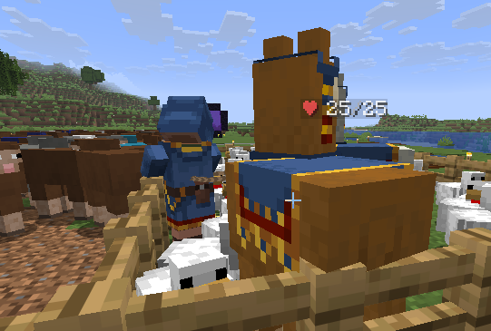
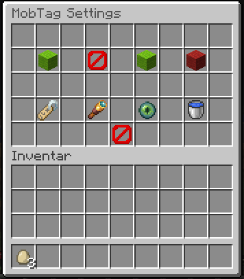
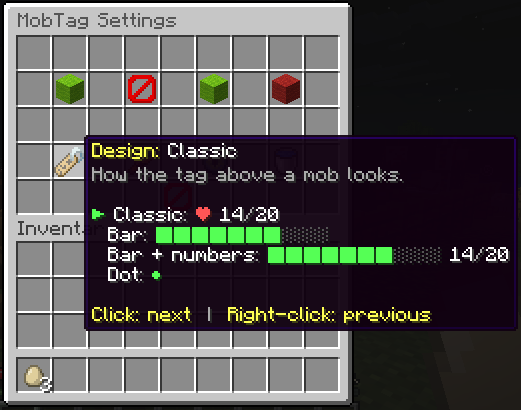

Auf unserem
[Minecraft-Server]()
fehlte eine Anzeige, wie viel Leben ein Mob noch hat. Das Plugin
[MobTag](https://github.com/Abood8001/MobTag) von Abood8001 kann das und ist
Open Source (MIT). Ich habe es geforkt, also eine eigene Kopie angelegt, und um
ein paar Einstellungen pro Spieler erweitert:
[TechnikWeber/MobTag](https://github.com/TechnikWeber/MobTag).

<figure class="abb klein">
  
  <figcaption>Klassische Anzeige über einem Lama.</figcaption>
</figure>

## Was der Fork dazubringt

- **Design pro Spieler:** Klassisch (❤ 14/20), Balken, Balken mit Zahl oder
  nur ein Punkt in Grün, Gelb oder Rot.
- **Größe:** klein, mittel, groß. Die Anzeige ist leicht durchsichtig.
- **Wann:** immer, nur beim Anschauen oder nur bei Mobs, die man gerade
  getroffen hat. Letzteres ist bei uns Standard: Bei vielen Tieren auf der
  Weide war alles andere zu unruhig.
- **Zielanzeige:** auf Wunsch eine Bossleiste oben mit dem Mob, den man
  anschaut, gedacht für Bosskämpfe. Standardmäßig aus.
- **Aufgeräumte Config:** Bei Updates bleiben alle Erklärungen in der
  `config.yml` erhalten.

<figure class="abb klein">
  
  <figcaption>Oben Schalter, unten Design, Größe, Wann und Zurücksetzen.</figcaption>
</figure>

<figure class="abb klein">
  
  <figcaption>Die vier Designs mit Vorschau.</figcaption>
</figure>

Alles geht auch per Befehl, etwa `/mobtag style bar` oder `/mobtag show combat`.

## Installieren

Läuft auf Paper oder Spigot ab 1.21, getestet mit Paper 26.3.

1. `MobTag-….jar` von den
   [Releases](https://github.com/TechnikWeber/MobTag/releases) laden und in
   den Ordner `plugins/` legen.
2. Zusätzlich [PacketEvents](https://modrinth.com/plugin/packetevents) in
   `plugins/` legen. Ohne läuft MobTag auch, dann aber ohne eigene Designs und
   Größen pro Spieler.
3. Server neu starten, im Spiel `/mobtag` eingeben.

Standardwerte für neue Spieler stehen in `plugins/MobTag/config.yml`.
Geyser-Spieler auf Bedrock werden erkannt, getestet habe ich das aber noch
nicht.
