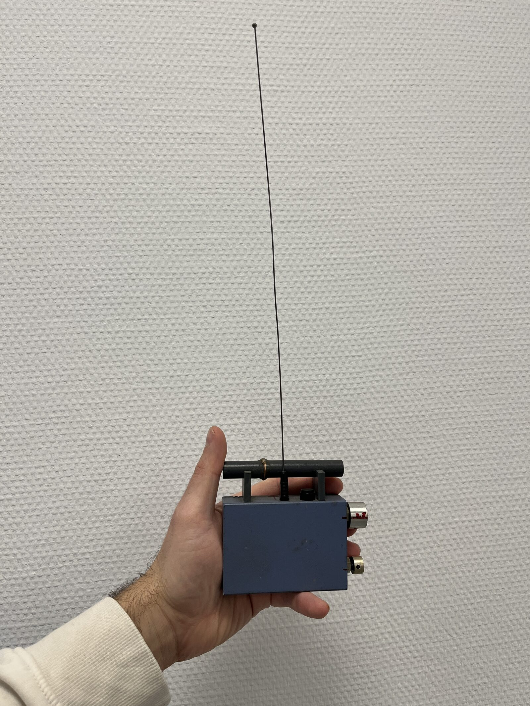
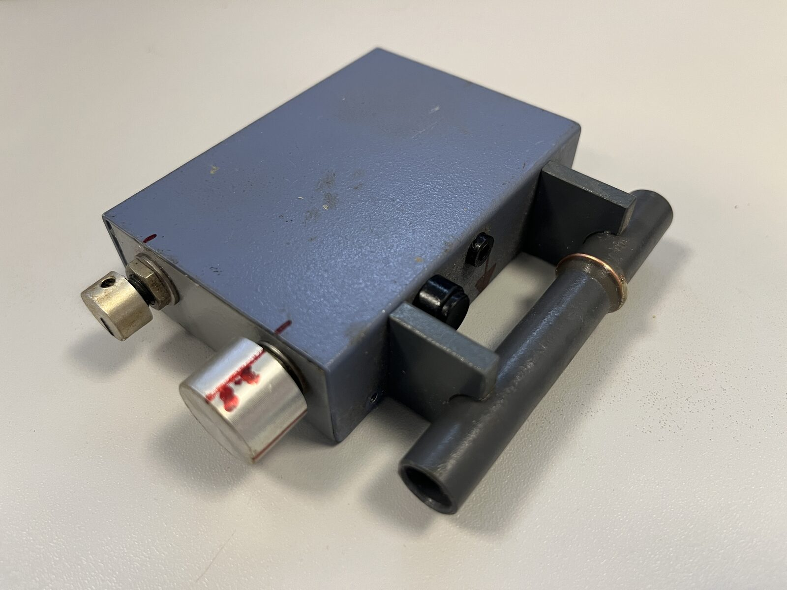
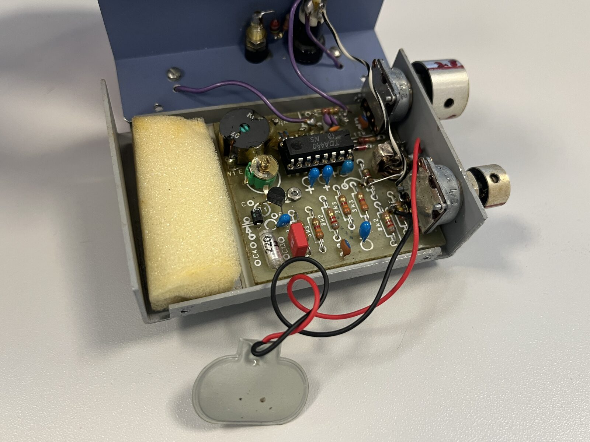
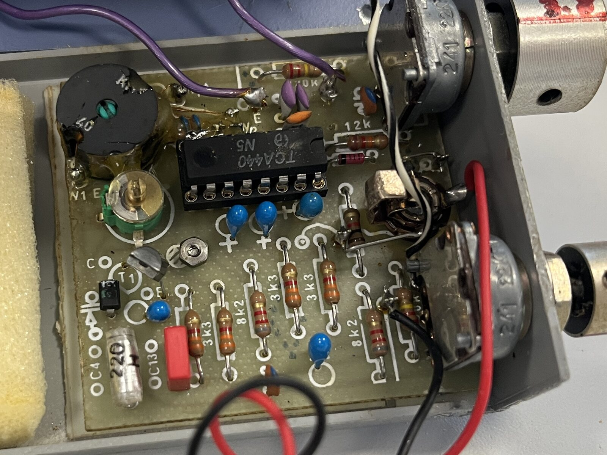

Ein Arbeitskollege hat mir einen selbst gebauten **Peilempfänger fürs
80-m-Band** mitgebracht – gebaut für die Fuchsjagd (ARDF), bei der man im
Gelände versteckte Sender aufspürt. Blechgehäuse, Rohr als Griff, Stabantenne
obendrauf, zwei Drehknöpfe. Woher der Bausatz stammt, weiß niemand mehr.

<figure class="abb klein">
  
  <figcaption>Handlich: Kästchen, Griff, Stabantenne.</figcaption>
</figure>

## So wird gepeilt

Im Rohr über dem Gehäuse steckt vermutlich die Ferritantenne. Sie empfängt
quer zum Stab laut und in Stabrichtung fast nichts. Gepeilt wird auf dieses
scharfe **Minimum**. Weil es an beiden Stabenden auftritt, bleibt offen, ob der
Fuchs vorne oder hinten sitzt. Dafür ist die Stabantenne da: Sie empfängt
rundum gleich. Per Taster zugeschaltet, addiert sich ihr Signal zu dem des
Ferritstabs – auf einer Seite verstärkt es sich, auf der anderen löscht es
sich aus. Aus der Acht wird eine Herzkurve mit nur einem Minimum.

<figure class="abb">
  

    <svg viewBox="0 0 580 265" role="img"
         aria-label="Drei Empfangsdiagramme von oben gesehen. Links die
                     Stabantenne: ein Kreis, rundum gleich laut. Mitte der
                     Ferritstab: eine Acht mit lauten Keulen quer zum Stab und
                     je einem Minimum an beiden Stabenden. Rechts Ferritstab
                     plus Stabantenne: eine Herzkurve, laut auf einer Seite,
                     nur ein Minimum auf der anderen.">
      <g font-family="system-ui, sans-serif" font-size="12" fill="#555"
         text-anchor="middle">
        <!-- Ueberschriften -->
        <g font-size="13" font-weight="600" fill="#333">
          <text x="97" y="22">Stabantenne</text>
          <text x="290" y="22">Ferritstab</text>
          <text x="483" y="22">Ferritstab + Stab</text>
        </g>
        <text x="97" y="40">rundum gleich</text>
        <text x="290" y="40">Acht – zwei Minima</text>
        <text x="483" y="40">Herz – ein Minimum</text>

        <!-- Diagramme -->
        <g fill="#f6e6da" stroke="#b3541e" stroke-width="1.6">
          <circle cx="97" cy="155" r="58"/>
          <circle cx="290" cy="107" r="48"/>
          <circle cx="290" cy="203" r="48"/>
          <path d="M535.0 165.0 L540.1 159.0 L544.4 151.9 L547.7 144.0 L549.8 135.2 L550.5 126.0 L549.8 116.5 L547.5 106.9 L543.7 97.6 L538.3 88.9 L531.5 81.0 L523.5 74.1 L514.4 68.5 L504.4 64.4 L493.8 61.9 L483.0 61.0 L472.2 61.9 L461.6 64.4 L451.6 68.5 L442.5 74.1 L434.5 81.0 L427.7 88.9 L422.3 97.6 L418.5 106.9 L416.2 116.5 L415.5 126.0 L416.2 135.2 L418.3 144.0 L421.6 151.9 L425.9 159.0 L431.0 165.0 L436.7 169.9 L442.7 173.6 L448.8 176.1 L454.8 177.5 L460.5 178.0 L465.7 177.6 L470.2 176.5 L474.1 174.9 L477.2 173.0 L479.5 171.0 L481.2 169.1 L482.2 167.4 L482.8 166.1 L483.0 165.3 L483.0 165.0 L483.0 165.3 L483.2 166.1 L483.8 167.4 L484.8 169.1 L486.5 171.0 L488.8 173.0 L491.9 174.9 L495.8 176.5 L500.3 177.6 L505.5 178.0 L511.2 177.5 L517.2 176.1 L523.3 173.6 L529.3 169.9 L535.0 165.0Z"/>
        </g>

        <!-- Antennen -->
        <circle cx="97" cy="155" r="4" fill="#333"/>
        <g fill="#8a8a85" stroke="#333">
          <rect x="262" y="151" width="56" height="8" rx="2"/>
          <rect x="455" y="161" width="56" height="8" rx="2"/>
        </g>

        <!-- Beschriftung -->
        <text x="97" y="185">überall</text>
        <text x="97" y="199">gleich laut</text>
        <g fill="#b3541e" font-weight="600">
          <text x="290" y="111">laut</text>
          <text x="290" y="207">laut</text>
          <text x="483" y="116">laut</text>
        </g>
        <text x="483" y="132" font-size="11">Fuchs auf dieser Seite</text>
        <g fill="#333" font-weight="600">
          <text x="226" y="159">Minimum</text>
          <text x="354" y="159">Minimum</text>
          <text x="483" y="200">Minimum</text>
        </g>
        <text x="483" y="216" font-size="11">leise</text>
      </g>
    </svg>
  

  <figcaption>Empfangsdiagramme von oben; der graue Balken ist der Ferritstab.</figcaption>
</figure>

Damit sich die Signale sauber auslöschen, müssen sie etwa gleich stark sein –
dafür sitzt vor der Stabantenne ein Widerstand, der 12 k weiter unten. Gepeilt
wird so:

1. Ohne Taster drehen, bis es am leisesten ist: Der Fuchs liegt auf der Linie
   des Stabs.
2. Um 90° drehen, Taster drücken, hinhören – dann umdrehen und vergleichen. Auf
   der lauteren Seite sitzt der Fuchs. Welche das ist, probiert man einmal an
   einem bekannten Sender aus.
3. Ein Stück weitergehen und neu peilen. Wo sich die Linien kreuzen, sitzt der
   Fuchs.

<figure class="abb">
  

    <svg viewBox="0 0 580 200" role="img"
         aria-label="Kreuzpeilung von oben: Von zwei Standorten unten links und
                     unten rechts führt je eine gestrichelte Peillinie nach
                     oben. Die Linien kreuzen sich am Fuchs.">
      <g font-family="system-ui, sans-serif" font-size="12" fill="#555">
        <g stroke="#b3541e" stroke-width="1.6" stroke-dasharray="6 4">
          <line x1="110" y1="170" x2="366" y2="12"/>
          <line x1="470" y1="170" x2="240" y2="14"/>
        </g>
        <circle cx="110" cy="170" r="6" fill="#333"/>
        <circle cx="470" cy="170" r="6" fill="#333"/>
        <text x="110" y="192" text-anchor="middle">1. Peilung</text>
        <text x="470" y="192" text-anchor="middle">2. Peilung</text>
        <circle cx="300" cy="53" r="9" fill="#b3541e"/>
        <text x="318" y="57" fill="#b3541e" font-weight="600">Fuchs</text>
      </g>
    </svg>
  

  <figcaption>Kreuzpeilung: zwei Peilungen von verschiedenen Orten.</figcaption>
</figure>

Einer der Knöpfe regelt die Empfindlichkeit, damit man das Minimum auch direkt
neben dem Sender noch hört.

<figure class="abb klein">
  
  <figcaption>Geschlossen, mit Griffrohr und Taster.</figcaption>
</figure>

## Das Herz: der TCA440

Fast die ganze Empfangstechnik steckt in einem 16-Pin-Chip: geregelte
HF-Vorstufe, Mischer, eigener Oszillator und ZF-Verstärker. Das Besondere ist
der **Regelumfang von über 100 dB** – genau das braucht man beim Peilen, vom
kaum hörbaren Fuchs in der Ferne bis zum Sender direkt vor der Nase. Er läuft
mit 4,5 bis 15 V und reicht bis etwa 50 MHz.

Gedacht war der TCA440 eigentlich für AM-Radios der 1970er. Valvo (Philips)
führte ihn schon 1974, Siemens noch Ende der 1980er in seinen Datenbüchern;
wer ihn ursprünglich entwickelt hat, konnte ich nicht sicher klären. In der DDR
gab es ihn als **A244D**. Der Peiler-Konstrukteur Nick Roethe, DF1FO, schreibt,
er stecke in fast allen 80-m-Peilempfängern – in seiner Version 4 hat er ihn
trotzdem ersetzt, weil gute Exemplare kaum noch zu bekommen sind.

<figure class="abb klein">
  
  <figcaption>Geöffnet: Platine, Potis, Schaumstoff fürs Batteriefach.</figcaption>
</figure>

<figure class="abb klein">
  
  <figcaption>TCA440, daneben der 12-k-Widerstand.</figcaption>
</figure>

## Welcher Bausatz ist das?

Am nächsten kommt der **„Foxy“ (AS064)** des
[AATiS e.V.](https://www.aatis.de/content/baus%C3%A4tze/tipps/AS064_Fuchsjagdempf%C3%A4nger-Foxy-Tipps)
– Schaltplan und Bestückungsplan stehen dort. Vieles passt: TCA440, zwei
22-k-Potis, 3,3 k und 8,2 k, der 220-µF-Elko und vor allem der **12-k-Widerstand**,
den der AATiS nachträglich statt 22 k empfiehlt. Die Platine ist aber anders
aufgeteilt, und statt des Verstärker-ICs LM386 sitzt ein einzelner Transistor
drauf. Vielleicht ein Vorgänger oder eine Abwandlung.

Im Netz werden noch der **PRX80S** von Dieter Schwider, DF7XU, und die
FJRX-Peiler von DF1FO genannt, zu denen Harald Gosch, OE6GC, eine
Aufbauanleitung geschrieben hat. Einen Bausatz „ARDF80“ habe ich nicht
gefunden.

Wer das Gerät erkennt: Ich freue mich über einen Hinweis.

## Quellen

- [AATiS: Fuchsjagdempfänger „Foxy“ – Tipps, Schaltung, Bestückungsplan](https://www.aatis.de/content/baus%C3%A4tze/tipps/AS064_Fuchsjagdempf%C3%A4nger-Foxy-Tipps)
- [OE6GC: Empfehlungen zum Aufbau des DF1FO-80-m-Peilers FJRX84 (PDF)](https://workplace.oevsv.at/export/oevsv/.galleries/ARDF/PDF-ARDF/2016-Empfehlungen-von-OE6GC-zum-Aufbau-des-DF1FO-80m-Peilers-FJRX84.pdf)
- [hamwaves.com: ARDF-Ausrüstung, u. a. PRX80S und HRX80](https://hamwaves.com/ardf.equipment/en)
- [TCA440-Datenblatt (Kurzfassung)](https://pe2bz.philpem.me.uk/Misc/-%20Animals/-%20Bat/TCA440-Chip/tca440.htm)
